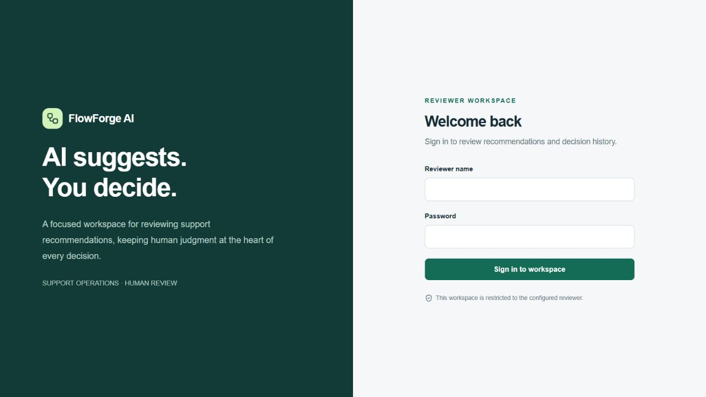
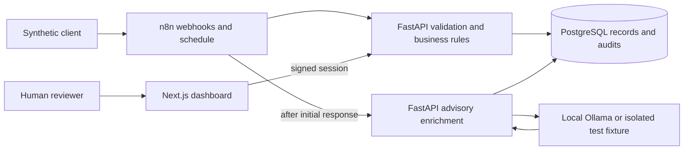

# FlowForge AI

**Local AI automation with deterministic rules, human review and an audit trail.**

FlowForge AI combines **n8n, FastAPI, PostgreSQL, Next.js and Ollama** for support
intake, lead deduplication and daily operations reporting. Validated AI advice is
stored separately from original customer records and human review decisions.

**Status:** All ten implementations are complete and accepted for a trusted-local
engineering portfolio, with documented security exceptions. The final release
includes the developer handoff, reproducible demos and measured test evidence.
Public production deployment is not approved.



*Actual existing UI, with no private records or credentials. A
[recording plan](docs/portfolio-presentation.md#recording-plan) covers all demos;
no video has been fabricated.*

## Business problems and engineering contributions

| Problem | Implemented workflow | Engineering contribution |
| --- | --- | --- |
| Repeated tickets and inconsistent triage | Validate/persist, respond, then enrich locally | Event idempotency, strict advisory schema, pinned model, bounded inference, durable human review |
| Leads repeated through retries/email aliases | Canonical email plus remembered events | Transactional deduplication, conflicts, existing details preserved and audited |
| Manual daily reporting | Scheduled/manual completed-day digest | One DB snapshot, date/timezone identity, frozen replay, explicit backfill |

Approval records **a review decision only**. Customer replies, payments and external
CRM actions are not implemented. The model cannot execute tools or approve itself.
Future delivery would need a separately implemented authorization gate.

## Why n8n and FastAPI together?

n8n owns visual orchestration, webhooks, schedules and routing. FastAPI owns
contracts, deterministic rules, transactions, model checks and authorization.
PostgreSQL is authoritative after ambiguous network delivery. Next.js presents
authenticated data. Business invariants remain independently testable.
See [architecture and trade-offs](docs/architecture.md).



## Run the isolated demos

Prerequisites: Python 3, Git, Docker and Compose **2.24.4+** (`!override` support).
Ubuntu WSL2 + Docker Desktop is the validated host. First builds need internet;
no paid API credentials are required.

```bash
git clone https://github.com/AdnanSherwani2003/flowforge-ai.git
cd flowforge-ai
python3 scripts/portfolio_lab.py start
python3 scripts/benchmark_portfolio.py --repetitions 3
python3 scripts/portfolio_lab.py status
```

The lab builds from source into a unique `ff-portfolio-*` Compose project with
independent volumes and generated credentials. It preserves the normal `.env`,
personal n8n and existing FlowForge services.

| Lab surface | URL |
| --- | --- |
| Reviewer UI | http://localhost:13000 |
| FastAPI | http://localhost:18001 |
| n8n | http://localhost:15679 |

Private login details: `state.json` under `$HOME/.local/share/flowforge-ai/portfolio-lab/`
(0600, parent0700). Inspect locally; never paste them into issues or recordings.
The default model transport is a **controlled HTTP fixture**, not real inference.
[Developer setup](docs/developer-setup.md) covers real local Ollama and fresh installation.
[Three demo guides](docs/portfolio-demos.md) provide exact steps and expected results.

```bash
python3 scripts/portfolio_lab.py stop
```

Only the owned lab stops; volumes/data remain. Subsequent `start` resumes without
imports or credential replacement. No reset or volume deletion is part of cleanup.

## Stack and responsibilities

| Component | Reviewed version/source | Responsibility |
| --- | --- | --- |
| FastAPI / Pydantic | Python 3.12; `backend/constraints.txt` | Contracts, transactions, authorization, model validation |
| SQLAlchemy / Alembic | SQLAlchemy 2; head `007_daily_digests` | Constraints and additive migrations |
| PostgreSQL | 17-alpine local image | Business records, identities, reviews and audit |
| n8n Community | 2.43.8; 13/11/5 nodes | Support/lead orchestration; 09:00 Asia/Kolkata digest |
| Next.js / React | 16.4.2 /19.3.1 | Reviewer/report UI |
| Ollama | Existing Windows 0.40.8; pinned `qwen2.5:3b-instruct` | Optional advisory classification |
| Docker Compose | WSL/Docker Desktop | Separate services and persistent volumes |

These are reviewed versions, not claims of latest or vulnerability-free releases.
Exact measured images/model are recorded in evaluation evidence; mutable base tags
and [open patch follow-ups](docs/implementation-09.md#m-open-security-and-maintenance-follow-ups) remain limitations.

## Testing and measurements

Fresh Implementation 10 verification passed 233 backend tests, 44 frontend tests
and the workflow/API/fault suites. The isolated fixture benchmark passed 20/20
scenarios in each of three repetitions: 60 passes and 120 replay deliveries with
zero extra canonical business records. Compound-case median was 72.111 ms and
P95 was 1461.627 ms; these are serial fixture timings, not inference or load SLAs.

```bash
# Requires configured normal services/model and the isolated lab.
# Serial execution retains synthetic test records.
python3 scripts/verify_portfolio.py
```

This runs backend/frontend tests, lint/types/build, workflow/API integrations,
isolated faults, publication parity, the portfolio benchmark, isolated recovery
and secret checks. Redacted results use `docs/evaluation/implementation-10-*`.

[Benchmark methodology/results](docs/benchmark-report.md) distinguish fresh 10
measurements from historical evidence. Fixture timings cannot establish real
inference latency or model accuracy; serial medians/P95 are not production SLAs.

Historical evaluation: category agreement **11/12**, priority **10/12**; median
inference **597 ms GPU /3189 ms CPU**. A lockout was over-prioritized and a vague
outage safely abstained. Twelve synthetic cases do not establish production
accuracy. [Original evidence](docs/implementation-04.md#genuine-local-model-results).

## Security and recovery

Backend auth protects reviews/digest reads; a scoped credential permits scheduled
generation only. Bodies/fields are bounded, SQL parameterized, errors sanitized,
sensitive responses no-store and customer text React-escaped. Advisory inference
has a fixed schema/model, timeout, one local slot, lease and explicit retry cap.
Original tickets survive model failures.

**Three accepted risks remain unresolved:** five absent historical autosaved
versions, critical/high image findings and legacy unauthenticated local ingress.
Loopback is not sender authentication; browser-form writes remain possible.
All seven follow-ups stay open. Historical/manual/crashed data and backups may
retain raw text; no-save is not erasure. Read the [security review](docs/security-review.md)
and [exception investigation](docs/implementation-09-exception-review.md).

The [recovery runbook](docs/recovery-runbook.md) separates automatic recovery,
explicit replay/retry, backfill and manual work. Isolated app restore was verified
in 09; normal/n8n restore, ownership and host-reboot recovery remain limited or
unverified. There is no outbox, sweeper, automatic write replay or unlimited
backfill. Changed environment needs recreation, not restart alone.

## Documentation and portfolio assets

- [Developer setup](docs/developer-setup.md)
- [Architecture and trade-offs](docs/architecture.md)
- [Three reproducible demos](docs/portfolio-demos.md)
- [Benchmark report](docs/benchmark-report.md)
- [Interview, recording and CV materials](docs/portfolio-presentation.md)
- [Ten-milestone roadmap and index](docs/roadmap.md)
- [Implementation 10 report](docs/implementation-10.md)
- [Developer handover](docs/codex-handover.md)

**Trusted-local engineering portfolio; not an approved public SaaS/production deployment.**
