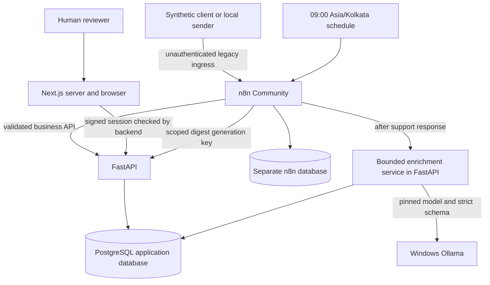
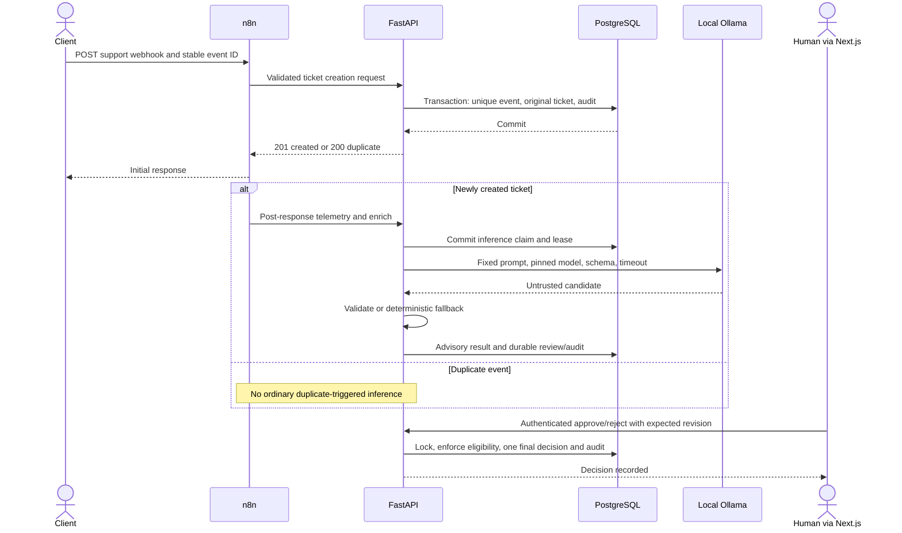

# Architecture and engineering decisions

Reviewed against source on 2026-10-24. This describes implemented trusted-local
behavior. [Setup](developer-setup.md), [demos](portfolio-demos.md) and
[security exceptions](implementation-09-exception-review.md) complement it.

## Components and trust boundaries

The normal Compose project is `flowforge-ai`: loopback 8001/3000/5679, PostgreSQL
unpublished on its internal network. The personal `n8n` container and `n8n_data`
volume are separate. The optional portfolio lab uses a unique `ff-portfolio-*`
project, independent volumes, private configuration and loopback 18001/13000/15679.

Loopback limits remote reachability; it does not authenticate senders or protect
against all browser-origin writes. Legacy intake/read/enrichment/telemetry routes
remain unauthenticated. Review authorization and scoped digest generation form
separate boundaries. This is not an Internet deployment design.

## Support request and advisory review

Support has 13 published nodes. The business commit precedes the initial webhook
response and inference. n8n's remaining execution is asynchronous from the
sender's perspective; it is not a durable job queue or outbox. A crash after the
response can leave missing enrichment. An ordinary replay resolves intake
identity but deliberately does not trigger inference; an explicit operator retry
recovers the advisory path. Telemetry is best effort and cannot override business
truth.

Original ticket text remains immutable through advisory enrichment and approval.
The model produces category/priority/confidence/reason advice in a separate row.
A durable review references its enrichment/revision. Approval is a **decision
record only**: no customer reply, payment, CRM dispatch or other outward action
is implemented. Therefore there is no delivery action that can bypass approval.
Future delivery requires a separately implemented and tested authorization gate.

## Deterministic data and deduplication

FastAPI/Pydantic validate bounded contracts before SQLAlchemy transactions.
PostgreSQL uniqueness and row locking arbitrate concurrent requests; a preflight
lookup alone would race. Ticket event replays return the original identity;
remembered event IDs with changed payloads conflict. Lead intake adds canonical
normalized email identities and remembered event identities. A new event for an
existing email returns the canonical lead without overwriting original details.
Lead observation/audit rows can grow on valid replays; the invariant is no extra
canonical business record, not no database writes whatsoever.

Reviews enforce authentication, expected revision, eligible inference status and
a single final decision. Idempotent decision replay retains the original final
timestamp/audit. These are bounded application guarantees, not exactly-once
network delivery. Clients must retain event identities across ambiguous outcomes.

## Local model boundary

The normal model is `qwen2.5:3b-instruct` with full digest
`357c53fb659c5076de1d65ccb0b397446227b71a42be9d1603d46168015c9e4b`.
The service checks model identity, uses a fixed prompt/schema, validates the
candidate and never executes generated instructions or tools. Supported output
enums, confidence rules and fixed reasons constrain persisted advice.
Injection markers and invalid/uncertain output abstain to attention with unknown
fields; unavailable/busy outcomes are explicit. Unknown/attention output cannot
be approved as a successful suggestion.

Inference is bounded to 25 seconds, one process-local slot, a120 second durable
lease and three total explicit attempts. A slot is not a distributed queue.
An interrupted/unavailable attempt preserves the already committed ticket;
lease expiry makes the problem visible but does not schedule an automatic retry.
Multiple backend replicas would require revisiting process-local limits.

The portfolio lab substitutes a controlled HTTP fixture by default. This tests
transport, validation and fallback without model download or variable inference;
it provides no model quality evidence.

## Leads and daily digests

The 11-node lead workflow validates/normalizes, calls FastAPI, routes
created/duplicate/conflict/failure outcomes and writes bounded telemetry.
The five-node digest workflow runs09:00 Asia/Kolkata and uses a narrowly scoped
header credential to request generation. A manual authenticated UI path supports
explicit one-day backfill; missed days are not automatically replayed.

A digest uses one repeatable database snapshot and a completed calendar day in
the configured timezone. Date/timezone identity prevents multiple canonical
reports. The frozen stored report replays unchanged; its activity refers to that
day, while its backlog reflects current state at generation. Backlog is not a
historical reconstruction. Invalid/future dates are rejected. Digest text is
deterministic aggregation, not an LLM summary.

## Security, recovery and trade-offs

| Decision | Benefit | Limit |
| --- | --- | --- |
| Business logic in FastAPI | Testable invariants independent of visual nodes | Two services/contracts to operate |
| Unique keys plus transactions | Retry/concurrency safety for identities | No network exactly-once claim |
| Post-response advisory work | Ticket response does not wait for inference | Dispatch gap needs explicit recovery |
| Local pinned model | No paid inference or customer-text cloud API | Host/GPU availability and model drift |
| Shared reviewer with signed short-lived sessions | Small trusted-local auth surface | No per-user lifecycle or immediate revocation |
| Separate immutable original/advice/decision | Reviewability and audit trail | Retained sensitive business data needs care |
| Frozen daily report | Reproducible replay | Explicit backfill; snapshot backlog is current |
| Compose isolation | Reproducible new databases/volumes | Mutable image tags and host-specific networking |

Request byte/field limits, safe malformed JSON errors, parameterized SQL, no-store
responses, React text escaping, password hashing, backend authorization and
same-origin checks on Next.js decision routes are implemented. They do not
resolve legacy unauthenticated ingress. HTTP/local cookies and shared identities
remain trusted-local limitations.

New completed n8n executions use no-save settings; historical/manual/crashed
records and backups can still contain raw payloads. Execution pruning is disabled,
but independent workflow-version pruning/compaction exists. Five older autosaves
remain absent; exact historical cause is unproven. Critical/high image findings
also remain. Retain all [seven follow-ups](implementation-09.md#m-open-security-and-maintenance-follow-ups).

The [runbook](recovery-runbook.md) covers readiness, response loss, replay,
model retry, component restart, lease expiry and explicit backfill. There is no
automatic outbox/sweeper. Existing volumes are never reset as recovery.
Implementation 10 re-ran isolated component failure drills; original/n8n restore
and full Windows reboot remain unverified.
