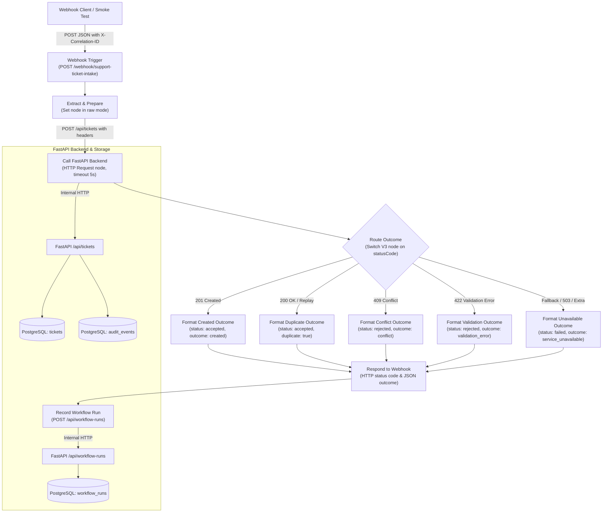

# FlowForge AI — Implementation 03: Deterministic n8n Workflow Orchestration

## 1. Implementation Objective

Implementation 03 establishes the first complete, deterministic workflow automation inside FlowForge AI. It connects incoming support webhook triggers through a dedicated n8n Community orchestration pipeline to the FastAPI backend and persistent PostgreSQL database.

The workflow acts strictly as an orchestrator:
- **FastAPI** remains the definitive authority for schema validation, business logic, duplicate detection, and persistence.
- **PostgreSQL** persists application records (`tickets`, `audit_events`, `workflow_runs`).
- **n8n Community** (running locally on port `5679`) extracts fields, calls the backend synchronously, branches deterministically based on HTTP status codes, formats outcome responses, responds to the webhook caller, and logs workflow run telemetry.
- **No external APIs, paid tiers, or LLM services** are introduced in this phase (Ollama AI enrichment is scheduled for Implementation 04).

---

## 2. Architecture Diagram



---

## 3. Workflow Execution Sequence

1. **Trigger**: Incoming HTTP `POST` arrives at `http://localhost:5679/webhook/support-ticket-intake`.
2. **Extraction & Sanitization**: Node `Extract & Prepare` extracts `source_event_id`, `subject`, `body`, preserves/generates `correlation_id`, captures n8n `execution_id`, and timestamps the request.
3. **Backend Submission**: Node `Call FastAPI Backend` sends `POST http://backend:8001/api/tickets` within the Docker network, propagating `X-Correlation-ID` and `X-Execution-ID` headers.
4. **Deterministic Routing**: Node `Route Outcome` evaluates the response status code:
   - `201`: Newly created ticket.
   - `200`: Idempotent duplicate replay.
   - `409`: Conflicting duplicate payload.
   - `422`: Schema or data validation error.
   - `Fallback (Extra output)`: Transient network failure, request timeout, connection reset, or HTTP 503.
5. **Outcome Normalization**: Exactly one formatting node formats a uniform outcome payload.
6. **Webhook Response**: Node `Respond to Webhook` delivers the structured JSON response and HTTP status code back to the client immediately, with correlation headers.
7. **Telemetry Persistence**: Node `Record Workflow Run` sends a non-blocking `POST http://backend:8001/api/workflow-runs` to record execution telemetry in PostgreSQL. Telemetry execution is best-effort and asynchronous to the webhook caller response.

---

## 4. Node-by-Node Explanation

| Node ID | Node Name | Node Type & Version | Purpose & Configuration |
| :--- | :--- | :--- | :--- |
| `node-webhook-01` | **Webhook Trigger** | `n8n-nodes-base.webhook` v2 | Listens on path `support-ticket-intake`, HTTP method `POST`. Configured with `responseMode: responseNode` so execution completes only after custom response formatting. |
| `node-extract-02` | **Extract & Prepare** | `n8n-nodes-base.set` v3.2 | Sanitizes input fields using `mode: raw`. Extracts `source_event_id`, `subject`, `body`, derives `correlation_id` from `X-Correlation-ID` header or generates a fallback identifier, captures `$execution.id`, and records ISO timestamp. |
| `node-backend-03` | **Call FastAPI Backend** | `n8n-nodes-base.httpRequest` v4.2 | Sends synchronous `POST http://backend:8001/api/tickets`. Sets `timeout: 5000`ms. Enabled `fullResponse: true` and `neverError: true` so HTTP 4xx/5xx status codes flow downstream rather than crashing n8n execution. Configured `onError: continueRegularOutput`. |
| `node-switch-04` | **Route Outcome** | `n8n-nodes-base.switch` v3.2 | Evaluates `$json.statusCode` against 4 rules (`201`, `200`, `409`, `422`). Configured with `fallbackOutput: "extra"` which routes unhandled status codes or network errors to output index 4. |
| `node-fmt-created-05` | **Format Created Outcome** | `n8n-nodes-base.set` v3.2 | Formats 201 Created payload with `status: accepted`, `outcome: created`, `duplicate: false`, and preserved `ticket_id`. |
| `node-fmt-dup-06` | **Format Duplicate Outcome** | `n8n-nodes-base.set` v3.2 | Formats 200 Replay payload with `status: accepted`, `outcome: duplicate_replayed`, `duplicate: true`, and existing `ticket_id`. |
| `node-fmt-conf-07` | **Format Conflict Outcome** | `n8n-nodes-base.set` v3.2 | Formats 409 Conflict payload with `status: rejected`, `outcome: conflict`, and safe conflict explanation. |
| `node-fmt-val-08` | **Format Validation Outcome** | `n8n-nodes-base.set` v3.2 | Formats 422 Validation payload with `status: rejected`, `outcome: validation_error`, and sanitized validation details. |
| `node-fmt-err-09` | **Format Unavailable Outcome** | `n8n-nodes-base.set` v3.2 | Formats 503 Fallback payload with `status: failed`, `outcome: service_unavailable`, and sanitized error notice without leaking internal network details or credentials. |
| `node-respond-10` | **Respond to Webhook** | `n8n-nodes-base.respondToWebhook` v1.1 | Sends HTTP response back to client with `respondWith: firstIncomingItem`, dynamic `responseCode: ={{ $json.http_status_code }}`, and response headers `X-Correlation-ID` and `X-FlowForge-Execution-ID`. |
| `node-telemetry-11` | **Record Workflow Run** | `n8n-nodes-base.httpRequest` v4.2 | Sends telemetry to `POST http://backend:8001/api/workflow-runs`. Configured with `neverError: true` so telemetry recording cannot break client response delivery. Idempotent on `(workflow_name, execution_id)`. |

---


### Reconciled Node Count (11 Nodes Canvas vs. 12 Draft)
The workflow contains exactly **11 nodes** both in the version-controlled JSON export and on the n8n editor canvas:
1. `Webhook Trigger` (`node-webhook-01`)
2. `Extract & Prepare` (`node-extract-02`)
3. `Call FastAPI Backend` (`node-backend-03`)
4. `Route Outcome` (`node-switch-04`)
5. `Format Created Outcome` (`node-fmt-created-05`)
6. `Format Duplicate Outcome` (`node-fmt-dup-06`)
7. `Format Conflict Outcome` (`node-fmt-conf-07`)
8. `Format Validation Outcome` (`node-fmt-val-08`)
9. `Format Unavailable Outcome` (`node-fmt-err-09`)
10. `Respond to Webhook` (`node-respond-10`)
11. `Record Workflow Run` (`node-telemetry-11`)

*Reconciliation Note*: An earlier development draft proposed a 12th node ("Format Telemetry Payload") situated between `Respond to Webhook` and `Record Workflow Run`. During final implementation, the telemetry payload mapping was inlined directly into the `Record Workflow Run` HTTP Request node using n8n expressions, eliminating the redundant intermediate node and streamlining execution.

## 5. HTTP Requests and Responses

### Example 1: New Ticket Creation (HTTP 201)
**Request:**
```http
POST /webhook/support-ticket-intake HTTP/1.1
Host: localhost:5679
Content-Type: application/json
X-Correlation-ID: corr-prod-001

{
  "source_event_id": "support-req-101",
  "subject": "Unable to access portal",
  "body": "User receives session timeout error upon login."
}
```

**Response:**
```http
HTTP/1.1 201 Created
Content-Type: application/json; charset=utf-8
X-Correlation-ID: corr-prod-001
X-FlowForge-Execution-ID: 15

{
  "http_status_code": 201,
  "status": "accepted",
  "outcome": "created",
  "ticket_id": "98e03d3f-58c3-4af8-a00b-1b9cffc4605c",
  "source_event_id": "support-req-101",
  "duplicate": false,
  "correlation_id": "corr-prod-001",
  "execution_id": "15",
  "timestamp": "2026-10-22T03:39:05.069+05:30"
}
```

### Example 2: Duplicate Replay (HTTP 200)
**Response:**
```http
HTTP/1.1 200 OK
Content-Type: application/json; charset=utf-8
X-Correlation-ID: corr-prod-002
X-FlowForge-Execution-ID: 16

{
  "http_status_code": 200,
  "status": "accepted",
  "outcome": "duplicate_replayed",
  "ticket_id": "98e03d3f-58c3-4af8-a00b-1b9cffc4605c",
  "source_event_id": "support-req-101",
  "duplicate": true,
  "correlation_id": "corr-prod-002",
  "execution_id": "16",
  "timestamp": "2026-10-22T03:39:23.434+05:30"
}
```

### Example 3: Conflicting Duplicate (HTTP 409)
**Response:**
```http
HTTP/1.1 409 Conflict
Content-Type: application/json; charset=utf-8
X-Correlation-ID: corr-prod-003
X-FlowForge-Execution-ID: 17

{
  "http_status_code": 409,
  "status": "rejected",
  "outcome": "conflict",
  "error": "Conflict: source_event_id 'support-req-101' already exists with different payload content.",
  "source_event_id": "support-req-101",
  "correlation_id": "corr-prod-003",
  "execution_id": "17",
  "timestamp": "2026-10-22T03:39:29.700+05:30"
}
```

### Example 4: Validation Failure (HTTP 422)
**Response:**
```http
HTTP/1.1 422 Unprocessable Entity
Content-Type: application/json; charset=utf-8
X-Correlation-ID: corr-prod-004
X-FlowForge-Execution-ID: 18

{
  "http_status_code": 422,
  "status": "rejected",
  "outcome": "validation_error",
  "error": "[{\"type\":\"value_error\",\"loc\":[\"body\",\"subject\"],\"msg\":\"Value error, Field cannot be empty or whitespace-only\",\"input\":\"\",\"ctx\":{\"error\":{}}}]",
  "source_event_id": "support-req-invalid",
  "correlation_id": "corr-prod-004",
  "execution_id": "18",
  "timestamp": "2026-10-22T03:39:35.035+05:30"
}
```

### Example 5: Service Outage or Network Failure (HTTP 503)
**Response:**
```http
HTTP/1.1 503 Service Unavailable
Content-Type: application/json; charset=utf-8
X-Correlation-ID: corr-prod-005
X-FlowForge-Execution-ID: 19

{
  "http_status_code": 503,
  "status": "failed",
  "outcome": "service_unavailable",
  "error": "Backend service is temporarily unreachable or timed out. Please retry shortly.",
  "source_event_id": "support-req-503",
  "correlation_id": "corr-prod-005",
  "execution_id": "19",
  "timestamp": "2026-10-22T03:39:40.120+05:30"
}
```

---

## 6. Event Correlation Strategy & Traceability

Full-lifecycle traceability is maintained across all systems:
1. **Webhook Ingestion**: Client optionally provides `X-Correlation-ID`. If missing, `Extract & Prepare` derives `corr-{executionId}-{random}`.
2. **Backend Propagation**: When calling `POST /api/tickets`, n8n forwards:
   - `X-Correlation-ID`: Shared business correlation identifier.
   - `X-Execution-ID`: n8n execution sequence identifier.
3. **Audit Trail Recording & Data Minimization**: FastAPI captures both headers and persists them in the `safe_detail` JSON column of `audit_events`. In accordance with data minimization principles, raw ticket subjects, bodies, and credentials are strictly excluded:
   ```json
   {
     "source_event_id": "support-req-101",
     "correlation_id": "corr-prod-001",
     "execution_id": "15",
     "subject_length": 25,
     "body_length": 43,
     "category": "unknown",
     "status": "received"
   }
   ```
4. **Workflow Telemetry Recording**: Upon completing the webhook cycle, n8n sends execution telemetry to `POST /api/workflow-runs`, persisting `execution_id`, `correlation_id`, `source_event_id`, `ticket_id`, `outcome`, `status_code`, and `safe_detail`.
5. **Client Response Headers**: Every response returns `X-Correlation-ID` and `X-FlowForge-Execution-ID`.

An operator can inspect any workflow run via:
```bash
curl http://localhost:8001/api/workflow-runs/{execution_id}
curl http://localhost:8001/api/tickets/{ticket_id}/audit
```

---

## 7. Duplicate Protection & Idempotency

- Idempotency is enforced strictly by **FastAPI and PostgreSQL**, not re-implemented inside n8n.
- A unique index on `tickets(source_event_id)` and payload hashing guarantees:
  - Exact replays return `200 OK` (`duplicate: true`) with the original `id`.
  - Conflicting replays with altered body/subject return `409 Conflict`.
- Replaying requests through n8n never creates duplicate database records or side effects.
- The telemetry endpoint `POST /api/workflow-runs` is similarly idempotent on `(workflow_name, execution_id)`.

---

## 8. Operational Reliability & Error Handling

- **Bounded Execution**: Network timeouts on all internal HTTP requests are capped at 5 seconds.
- **Fail-Safe Routing**: `neverError: true` on `n8n-nodes-base.httpRequest` prevents non-2xx status codes from halting the workflow, enabling graceful Switch routing.
- **Controlled 503 Fallback**: If the FastAPI backend is temporarily unreachable or returning 503, the workflow catches the error, outputs an explicit `503 Service Unavailable` structured outcome, and logs the incident without unbounded retries or memory exhaustion.
- **Strict Privacy**: Raw request bodies, credentials, and PII are stripped during field extraction. Only metadata lengths and safe status details are stored in audit logs.
- **Best-Effort Telemetry**: Node `Respond to Webhook` delivers the response to the caller first. `Record Workflow Run` executes asynchronously afterwards with `neverError: true`, ensuring that any telemetry backend error never impacts the caller's confirmed response.

---


---

## 8.1 Final Hardening Enhancements

During the Implementation 03 Final Hardening review, the following enterprise-grade security and reliability enhancements were verified:

1. **Alembic Migration 003 (`003_workflow_runs_unique`)**:
   - Added a PostgreSQL unique constraint `uq_workflow_runs_workflow_execution` on `workflow_runs(workflow_name, execution_id)`.
   - Updated `WorkflowRunService.record_run()` with concurrent `IntegrityError` rollback-and-retrieve handling.
   - Tested under high-concurrency multi-threaded conditions (`test_real_postgres_workflow_run_concurrency`).

2. **Error Sanitization & Zero PII Leakage**:
   - Overrode FastAPI default `RequestValidationError` handler in `backend/app/main.py`. Stripped Pydantic v2's raw `"input"` reflection to ensure user submitted ticket bodies/subjects are never echoed back in HTTP 422 errors.
   - Updated n8n `Format Validation Outcome` node to output clean field-level error messages (`field: msg`) without echoing raw input text.
   - Verified that HTTP 503 fallback responses contain only safe error notifications (`"Backend service unavailable"`), never leaking internal network IPs, port numbers, or stack traces.

3. **Isolated Failure Simulation Hooks**:
   - Introduced configuration flag `ENABLE_FAILURE_SIMULATION: bool = False` (defaulting to `False`).
   - Replaced body/source-event simulation triggers with an explicit, secure header requirement: `X-FlowForge-Simulate: 503|timeout|conn-reset|timeout-after-persist`.
   - Verified that ordinary user requests containing `"503"`, `"timeout"`, or `"test-sim-"` strings in subjects or bodies create tickets normally (`201 Created`) without triggering simulation.

4. **Retry Correctness (Pre- vs. Post-Persistence)**:
   - Verified two distinct retry failure scenarios:
     - **Pre-persistence failure (Case A)**: When backend fails with 503 *before* database commit, caller retry successfully creates the ticket (`201 Created`). Subsequent retry returns `200 Duplicate`.
     - **Post-persistence timeout (Case B)**: When backend persists the ticket but network times out before HTTP response arrives (`timeout-after-persist`), caller retry detects the existing record and returns `200 Duplicate` with the existing ticket ID. Exactly one ticket is created in PostgreSQL.

## 9. Local Setup & Workflow Import Instructions

### Dedicated Environment Boundary
- FlowForge n8n runs on host port **5679** (service `n8n`, container `flowforge-ai-n8n-1`).
- The user's personal n8n runs on host port **5678** (container `n8n`, volume `n8n_data`) and is **never modified**.

### Import & Publication Procedure
The exported workflow is version-controlled at `workflows/support_ticket_intake.json` and mounted into the container at `/workflows/support_ticket_intake.json`:

```bash
# 1. Import workflow definition into FlowForge n8n
docker compose exec n8n n8n import:workflow --input=/workflows/support_ticket_intake.json

# 2. Publish (activate) the workflow
docker compose exec n8n n8n publish:workflow --id=FlowForgeSupportIntake01

# 3. Restart n8n container to register active webhook routes
docker compose restart n8n
```

---

## 10. Webhook URL Mechanics: Test vs. Production

n8n differentiates between test and production webhooks:
- **Test Webhook (`/webhook-test/...`)**:
  - Requires the n8n UI canvas to be actively open in "Listen for test event" mode.
  - Automatically unregisters after one execution or on timeout.
- **Production Webhook (`/webhook/...`)**:
  - Persistent endpoint: `http://localhost:5679/webhook/support-ticket-intake`.
  - Accessible only when the workflow is **published and active** in n8n.
  - Single-instance n8n requires restarting the service or publishing via CLI so startup triggers register the persistent path into `webhook_entity`.

---

## 11. Testing & Verified Results

### Acceptance Test Suite (`scripts/test_support_workflow.py`)
Run the automated end-to-end acceptance script:
```bash
python3 scripts/test_support_workflow.py
```

### Verified Test Results:
```
======================================================================
 FlowForge AI — Implementation 03 Live Acceptance & Reliability Test
======================================================================
Target n8n Webhook: http://localhost:5679/webhook/support-ticket-intake
Target FastAPI Backend: http://localhost:8001

--- 1. Health & Infrastructure Verification ---
  [PASS] FastAPI /health endpoint is operational (200 OK)

--- 2. Loading Test Fixtures ---
  [PASS] Synthetic test fixtures loaded (>= 10 cases)

--- 3. Testing 10 Scripted First-Time Ticket Submissions ---
  [PASS] Case 01: Unable to access account dashboard... -> 201 Created
  [PASS] Case 02: Billing discrepancy on invoice INV-2026-089... -> 201 Created
  [PASS] Case 03: Webhook delivery failure to endpoint... -> 201 Created
  [PASS] Case 04: API rate limit encountered during sync job... -> 201 Created
  [PASS] Case 05: SSO authentication failure via SAML 2.0... -> 201 Created
  [PASS] Case 06: CSV export contains corrupted UTF-8 character... -> 201 Created
  [PASS] Case 07: Missing audit log events for deleted users... -> 201 Created
  [PASS] Case 08: Permission escalation issue in team workspace... -> 201 Created
  [PASS] Case 09: Password reset email delivery delay... -> 201 Created
  [PASS] Case 10: Mobile viewport rendering issue in notificati... -> 201 Created

--- 4. Database Persistence & Execution Traceability Verification ---
  [PASS] Created ticket exists in PostgreSQL via GET /api/tickets/{id}
  [PASS] Ticket audit trail contains correlation_id and execution_id
  [PASS] Audit safe_detail strictly excludes raw subject and body (Data Minimization)
  [PASS] Workflow run telemetry recorded in /api/workflow-runs/{execution_id}

--- 5. Idempotency & Replay Protection ---
  [PASS] Identical duplicate replay returns 200 OK with duplicate: true and same ticket_id

--- 6. Conflicting Duplicate Protection ---
  [PASS] Conflicting replay is rejected with HTTP 409 Conflict

--- 7. Validation Failure Routing ---
  [PASS] Edge case 'missing_subject' rejected with HTTP 422 validation_error
  [PASS] Edge case 'missing_body' rejected with HTTP 422 validation_error
  [PASS] Edge case 'missing_source_event_id' rejected with HTTP 422 validation_error
  [PASS] Edge case 'whitespace_only_subject' rejected with HTTP 422 validation_error
  [PASS] Edge case 'whitespace_only_body' rejected with HTTP 422 validation_error
  [PASS] Edge case 'oversized_subject' rejected with HTTP 422 validation_error
  [PASS] Edge case 'oversized_event_id' rejected with HTTP 422 validation_error

--- 8. Failure Simulation Isolation ---
  [PASS] Ordinary user request containing '503' string creates ticket normally (201 Created)

--- 9. Real Failure Modes & Reliability Verification ---
  [PASS] Live HTTP 503 response routes to service_unavailable with 503 status code
  [PASS] Live backend timeout terminates in bounded time (5.07s <= 8.0s) with HTTP 503
  [PASS] Live connection drop returns controlled HTTP 503 without crashing workflow

--- 10. Retry Correctness (Pre- vs. Post-Persistence) ---
  [PASS] Case A Step 1: Pre-persistence failure produced 503
  [PASS] Case A Step 2: Retry creates exactly one ticket (201 Created)
  [PASS] Case A Step 3: Second replay detects duplicate (200 OK)
  [PASS] Case B Step 1: Post-persistence timeout produced 503 to client
  [PASS] Case B Step 2: Retry correctly detects existing record and returns 200 duplicate (No duplicate tickets)

--- 11. Workflow Run Telemetry Idempotency ---
  [PASS] Workflow run endpoint is idempotent on (workflow_name, execution_id)

======================================================================
 Summary: 35 / 35 assertions passed.
======================================================================
```

### Backend Test Suite (`pytest`):
```bash
docker compose run --rm backend pytest -v
```
**Result**: 30 passing tests (100% pass rate in 1.11s).

---

## 12. Known Limitations & Future Integration Points

- **Service-to-Service Ingress Authentication**: In the local development network, `POST /api/workflow-runs` is internal-only. Prior to opening any external ingress, a shared token or mTLS boundary should be configured.
- **No AI Classification Yet**: Tickets currently enter with category `unknown`. AI enrichment with local Ollama (`qwen2.5:7b-instruct` / `llama3.2`) will be implemented in **Implementation 04**.
- **No Human Review Dashboard**: Manual review of low-confidence actions will be introduced in **Implementation 05**.
- **No Outbound Customer Messaging**: Outward email or customer notifications remain intentionally disabled until approval controls are in place.
