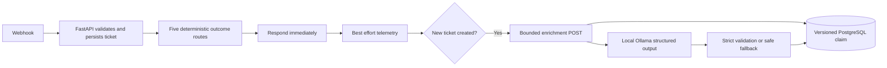

# Implementation 04 — Bounded local advisory enrichment

Implemented on 2026-10-22; final acceptance rerun on 2026-10-23; **uncommitted and unpushed** on
`implementation-04-ollama-enrichment`. Implementation 05 has not started.

## Objective and architecture

Add category and priority recommendations without changing original ticket content,
category, status or business actions. FastAPI owns validation, persistence and
idempotency; n8n orchestrates; Ollama generates suggestions only.



Original routes remain 201 created, 200 duplicate replay, 409 conflict, 422 validation
and 503 unavailable. AI runs after the initial response. No customer replies, tool
calls, approvals, ticket mutations or downstream business actions are added.

## Implementation 03 merge completed first

Initial clean branch: `implementation-03-deterministic-workflow` at `1489752`.
Fetched main was `515b37d` (Implementation 02). Parent checks confirmed the linear
chain `515b37d -> 26a1184 -> 1489752`; `git merge --ff-only` succeeded.
82 backend tests, 192 webhook assertions, eight smoke stages and runtime verification
passed on main before pushing. `git ls-remote origin refs/heads/main` confirmed
`1489752c5a3f988d2a6d57f81cd854b77d830077`. No branches were deleted.
The Implementation 04 branch was created from that verified main.

## Ollama setup and selection

Reused existing official Windows Ollama **0.40.8**, listening on loopback port 11434.
Backend reaches it at `http://host.docker.internal:11434`. No listener/firewall
changes or second installation/Compose service were needed.

| Property | Selected model |
| --- | --- |
| Tag | `qwen2.5:3b-instruct` |
| Digest | `357c53fb659c5076de1d65ccb0b397446227b71a42be9d1603d46168015c9e4b` |
| Parameters / quantization | 3.1B / Q4_K_M |
| Download size | 1,929,912,432 bytes |
| Persistent Windows storage | `C:\Users\Acer\.ollama\models` |
| License | Qwen Research License for the 3B variant; review terms for reuse |

Downloaded exactly one local model. Its footprint and measured latency suit the
detected 6 GB RTX 3050 and 24 GB host; CPU also works. No larger comparison was
needed for this advisory scope. Free local execution does not imply unrestricted
commercial licensing. The pre-existing cloud model was left untouched and never
called. Cloud tags, remote model metadata and digest mismatches are rejected.

References: [model/license](https://ollama.com/library/qwen2.5:3b-instruct),
[chat API](https://docs.ollama.com/api/chat),
[structured output](https://docs.ollama.com/capabilities/structured-outputs).

### Setup on another machine

Use its existing suitable local Ollama, or install the official runtime locally.
On the Windows host: `ollama pull qwen2.5:3b-instruct`. Verify tag/digest through
`/api/tags`; do not expose the unauthenticated API publicly.

```bash
docker compose build backend
# Take a protected database backup before applying migrations.
docker compose run --rm --no-deps backend alembic upgrade head
docker compose up -d --no-deps --force-recreate backend
```

This machine is already migrated and running. Environment changes require
container recreation; `docker compose restart` does not reload changed variables.

| Setting | Default / behavior |
| --- | --- |
| `FLOWFORGE_ENRICHMENT_ENABLED` | true; Compose maps to backend `ENRICHMENT_ENABLED` |
| `OLLAMA_BASE_URL` | `http://host.docker.internal:11434` |
| `OLLAMA_MODEL` / `OLLAMA_MODEL_DIGEST` | Pinned tag/digest above |
| `OLLAMA_TIMEOUT_SECONDS` | 25; startup validation permits 1–30 seconds |
| `OLLAMA_NUM_GPU` | -1 runtime default; 0 CPU |
| `ENRICHMENT_MAX_INPUT_CHARS` | Backend default 3000 combined subject/body characters |

The last setting requires explicitly adding it to backend environment configuration
to override. Input is never silently truncated. Oversized tickets remain accepted
but receive needs_review. Endpoints allow only loopback and explicit local
`host.docker.internal`/`ollama` hostnames; redirects and HTTP environment proxies
are disabled. Digest changes require explicit configuration and yield a new
versioned enrichment row.

### Windows restart and unavailable-service recovery

After a PC restart, sign in to Windows, open Docker Desktop and wait for its engine
to become ready. Run `docker compose up -d` in the Ubuntu repository. Open **Ollama**
from the Windows Start menu if its background server is not already running.
Final acceptance found the existing `Ollama.lnk` Windows startup shortcut. Its
presence alone does not guarantee Windows has enabled it in Startup apps; no
startup registration or system settings were changed during this review.

In Windows PowerShell, check `Invoke-RestMethod http://localhost:11434/api/version`
and `Invoke-RestMethod http://localhost:11434/api/tags`. Confirm the local tag and
pinned digest above. `Get-NetTCPConnection -State Listen -LocalPort 11434` should
show `127.0.0.1:11434`, as observed during final acceptance. No additional model
download is needed on this machine.

If the tray app is fully stopped, `ollama serve` is an alternative foreground
server using the existing installation. Do not start a competing server when the
port is already occupied. See the official [Windows guidance](https://github.com/ollama/ollama/blob/main/docs/windows.mdx)
for background operation, tray relaunch and the CLI server.

Check the Docker-to-Windows path from Ubuntu:

```bash
docker compose exec -T backend python -c "import urllib.request; print(urllib.request.urlopen('http://host.docker.internal:11434/api/version', timeout=3).status)"
```

Expected result is 200. If Windows succeeds but Docker fails, check Docker
Desktop/WSL readiness and the configured `host.docker.internal` endpoint. Preserve
the existing loopback listener and network protections.

While Ollama is offline, ticket acceptance and duplicate protection continue.
Enrichment reports HTTP 503 with an `unavailable` outcome and a safe diagnostic
such as `unreachable`, `timeout` or `busy`; the committed ticket remains intact.
Relaunch the existing Ollama app, verify both connectivity checks, then inspect
`GET /api/tickets/{id}/enrichment`. Explicitly retry an eligible unavailable result
with `POST /api/tickets/{id}/enrich?retry_unavailable=true`. The same versioned row
is reused and three total attempts remain the maximum. An active processing row
returns 202; an interrupted claim becomes recoverable on POST after 120 seconds.

There is no automatic backfill or retry after recovery. Success/needs_review
records replay without inference. If execution stopped before the AI node and no
row exists, a normal enrich POST requests it. Exhausted unavailable results need
operator review; retain their records and attempt counters. Simply relaunching
Ollama requires no migration, workflow import or backend recreation.

## Prompt and validation pipeline

`backend/app/prompts/support_ticket_v1.py` defines `support-triage-v1`. The system
prompt defines taxonomy, priority rubric and advisory boundaries; the user message
wraps subject/body as untrusted JSON data.

Strict model fields: category, priority, printable reason (1–200 characters) and
optional finite confidence in [0,1]. Extras and coercion are rejected.
Categories: billing, account_access, technical_issue, shipping, general, unknown.
Priorities: low, medium, high, unknown. Unknown category and priority must occur
together. Model identity/digest and prompt/schema versions are server-owned
response metadata, not fields the model can choose.

Confidence is self-reported, not a calibrated probability. Values below 0.65
abstain. The model-written reason is validated and discarded; a fixed generic
category explanation is persisted/returned to avoid copied customer text.

Generation uses JSON schema, non-streaming output, temperature 0, seed 42,
2048 context tokens and at most 160 generated tokens. The 25-second async deadline
covers metadata and inference; connection timeout is two seconds. Wrapper size is
bounded to 65,536 bytes even without Content-Length; inner content to 4096 bytes.
Duplicate keys, non-finite numbers, tool calls, truncation and invalid schemas fail
safely. No raw output, upstream errors or duplicated ticket text are persisted.

Preflight instruction markers are a conservative heuristic with false positives
and bypasses. Strict validation, fixed destinations and absence of executable
actions provide the actual security boundary.

## Persistence and API

Additive migration `004_ticket_enrichments` follows `003_workflow_runs_unique`.
It adds only `ticket_enrichments`, preserving existing tables and records.
The row contains a ticket foreign key, model/digest, prompt/schema versions,
validated advisory fields/status, safe diagnostics, attempt counter, timestamps
and optional token/latency counters. Foreign-key deletion is restricted.

Uniqueness: `(ticket_id, model, model_digest, prompt_version, schema_version)`.
Check constraints enforce status/enums, confidence, attempts, unknown pairs and
processing leases. A durable claim commits before network I/O, releasing database
connections/locks. Concurrent requests share one row. A claim token prevents late
completion from overwriting a newer attempt.

Claims interrupted for 120 seconds are recovered on the next POST. GET is strictly
read-only. Unavailable results are cached; only explicit `retry_unavailable=true`
retries, atomically, with three total attempts maximum. Success/needs_review replay
without inference. Version changes create new rows and retain previous results.
GET currently selects only the configured version.

Audit events contain safe IDs, status, diagnostic code, model/version and validated
trace IDs. No customer text or model-written reason is added to audit metadata.

| Operation / status | Contract |
| --- | --- |
| `POST /api/tickets/{id}/enrich` | Request current-version advisory result |
| `GET /api/tickets/{id}/enrichment` | Read current-version result, no inference |
| POST 201 | First completed success or abstention |
| POST 200 | Replayed success/abstention, or successful explicit retry |
| POST 202 | Existing processing claim; `Retry-After: 2` |
| POST 503 | Safe persisted unavailable result, including unavailable replay |
| 404 | Missing ticket; GET also returns 404 without current result |
| 422 | Invalid tracing/request parameters before persistence |

Response includes `advisory_only: true`, duplicate/retry flags and model/version
metadata. Only succeeded has a concrete category/priority.

| Trigger | Fallback |
| --- | --- |
| Long input / instruction markers | needs_review, unknowns, no inference |
| Malformed inner JSON/schema | needs_review / invalid_output |
| Unknown / low confidence | needs_review / abstained |
| Missing model / digest mismatch / remote metadata | unavailable, safe diagnostic |
| Offline / timeout / oversized or malformed wrapper | unavailable, safe diagnostic |
| Disabled / occupied inference slot | unavailable / disabled or busy |

One process-local inference slot permits at most 100 ms queue wait before returning
busy. This deliberately bounds resource use during bursts; busy rows require an
explicit retry. Deployment uses one Uvicorn worker; each extra worker would have
its own slot. No persistent job queue or autonomous retry scheduler was added.

## Published n8n integration

Stable workflow `FlowForgeSupportIntake01` remains the sole POST webhook owner.
Published version: `4a1f9756-89ab-488c-9348-f9fb51e0966e`.

The original eleven node IDs, parameters, routes and privacy settings are preserved.
Two supported nodes follow `Record Workflow Run`:

1. `Only Newly Created Tickets` (If 2.2) checks the original response's created outcome.
2. `Request Advisory Enrichment` (HTTP Request 4.2) POSTs its ticket ID, forwards
   safe tracing, accepts error responses and continues on transport errors,
   with a 35-second timeout.

The initial response is already delivered. Telemetry keeps its three-second
best-effort bound; telemetry failure still continues to the guard. Duplicate,
conflict, validation and unavailable routes skip AI.

Updated through the authenticated editor/publication dialog; no direct n8n database
mutations or production CLI imports. The export matches actual published nodes,
connections and settings. The editor imports by appending: import only the new two
nodes and connect telemetry to the guard when extending an existing canvas.
Importing the whole export into an existing canvas would duplicate nodes.

## Verification and synthetic evaluation

| Suite | Pass | Fail | Skip |
| --- | ---: | ---: | ---: |
| Backend pytest, including original 82 | 137 | 0 | 0 |
| Normal webhook assertions | 192 | 0 | 0 |
| API smoke stages | 8 | 0 | 0 |
| Isolated transport and AI outage assertions | 39 | 0 | 0 |
| Published enrichment workflow assertions | 21 | 0 | 0 |

Backend tests cover strict schemas, metadata pinning, malformed/oversized/truncated
output, network failures, hard deadline, guards, replay/status/retry semantics,
read-only GET, unchanged tickets, stale completion, forced five-connection
PostgreSQL claim race, constraints and real Alembic upgrade/downgrade in a fresh
disposable schema retaining a synthetic existing ticket. Production was upgraded
only. Existing library deprecation warnings remain.

The fault harness uses disposable tmpfs n8n and a synthetic proxy, without
production volumes/credentials. Existing RST/refusal, timeout and pre/post-persistence
retry checks remain, plus a genuine post-response AI-service outage scenario.

### Genuine local model results

Fixtures: `backend/tests/fixtures/enrichment_eval.json`.
GPU and CPU results: `docs/evaluation/implementation-04-gpu.json` and
`implementation-04-cpu.json`. Both runs produced the same measured agreements.

| Metric | Result |
| --- | --- |
| Pipeline category agreement | 11/12 = 91.7% |
| Pipeline priority agreement | 10/12 = 83.3% |
| Actual model cases, excluding two preflight guards | 10 |
| Model category / priority agreement | 9/10 / 8/10 |
| Needs-review rate | 5/12 = 41.7%: two guards, two abstentions, one invalid output |
| Invalid-output rate | 1/10 model cases = 10%; 1/12 pipeline cases |
| Unavailable | 0/12 in each sequential evaluation |
| GPU median / first eval case / maximum | 597 / 3398 / 3398 ms |
| CPU median / first eval case / maximum | 3189 / 9380 / 9380 ms |

First inference after installation: 6647 ms. Additional CPU probe: 9649 ms.
Initial webhook response latencies: 105/126/113 ms; final deployed rerun: 117/90/64 ms.
Exact final suite counts are recorded in docs/evaluation/implementation-04-verification.json.
A locked individual account was over-prioritized high instead of medium.
The widespread outage example failed validation and safely abstained.
These small synthetic results are not production accuracy estimates.
Passing validation tests does not imply perfect model judgment.

### Resources

RTX 3050 Laptop: 6144 MiB VRAM; WSL: 11,804 MiB RAM within the 24 GB host.
Ollama `/api/ps` reported GPU model allocation 2,085,974,179 bytes (all VRAM),
CPU allocation 2,090,776,656 bytes (zero VRAM), context 2048.
These are loaded allocation observations, not process RSS or peak-memory measures.
Docker snapshot: backend 71.03 MiB, n8n 440.9 MiB, PostgreSQL 83.9 MiB.
`keep_alive` is two minutes. Measurements/caveats are in
`docs/evaluation/implementation-04-resources.json`.

### Reproduce tests and demo

Run sequentially with no competing ticket writers. Synthetic business records remain.

```bash
docker compose exec -T backend pytest -q
python3 scripts/test_support_workflow.py
python3 scripts/smoke_test.py
python3 scripts/test_workflow_faults.py
python3 scripts/test_enrichment_workflow.py
python3 scripts/verify_workflow_runtime.py

docker compose run --rm --no-deps -e PYTHONPATH=/app -v "$PWD:/workspace:ro" backend python /workspace/scripts/evaluate_enrichment.py
# Append --cpu for a CPU benchmark without changing running backend settings.
```

Send a unique source_event_id, subject "Refund request" and body "I was charged
twice. Please refund the duplicate payment." to the regular webhook. Its 201 response
provides TICKET_ID. Poll `GET /api/tickets/TICKET_ID/enrichment` afterward.
Replay the same webhook body: HTTP 200, same ticket, same enrichment.

Manual API: `POST /api/tickets/TICKET_ID/enrich`.
An inspected unavailable result can be retried via
`POST /api/tickets/TICKET_ID/enrich?retry_unavailable=true`.

## Preservation, limitations and rollback

`docs/evaluation/implementation-04-preservation.json` records all baseline IDs
retained: tickets, audit, leads, telemetry, five workflows, workflow history and
333 execution/data rows. Four inactive draft definitions/publication states are
unchanged. Credential/encryption configuration hashes and named-volume mounts
are unchanged. Every pre-existing container except backend retains its ID, image
and start time, including personal n8n, SentinelPOMDP and Neo4j.
No raw customer/model data, credentials, environment files or backups are added
to Git. Evaluation data is synthetic. Failure simulation remains false.

Pre-migration custom-format backup was verified under
`/home/adnan/.local/share/flowforge-ai/backups/implementation-04-20261022T145614Z`,
file mode 0600, protected directory. No production restore/reset occurred.

Known limits:
- Local APIs lack production authentication/rate limiting.
- Heuristic prompt filters have bypasses/false positives; all suggestions are advisory.
- Schema-valid classifications can still be wrong; review is required before actions.
- Character/context bounds and deadlines can cause abstention/unavailability.
- Burst busy outcomes require explicit retry. A crash before the AI node can leave
  no enrichment; an operator can request it through POST.
- Runtime/hardware changes can affect outputs despite seed, temperature and pinning.
- Ticket text reaches local model memory; historical/crashed n8n data and protected
  backups can retain raw content. No model logging privacy guarantee is claimed.
- GET selects only the current version; older rows remain in storage.
- Native Ollama is externally managed and must remain available for demonstrations.

Pause AI with `FLOWFORGE_ENRICHMENT_ENABLED=false` and recreate only backend.
Tickets remain functional; enrichment returns safe unavailable outcomes.
To return to Implementation 03, republish its eleven-node export using the supported
editor and deploy verified main backend/Compose configuration. **Retain migration
004 and its table.** Never drop its data or restore an old dump just to disable AI.

## Next action

Implementation 04 is verified for the local advisory scope. Review the diff and
evidence; explicit approval is required before commit or push. Recommended message:
`feat: add bounded local Ollama ticket enrichment`.
No operational user action is required now. Implementation 05 remains out of scope.

Final acceptance was rerun on 2026-10-23. See the [final acceptance report](implementation-04-final-acceptance.md)
for executed suite counts, preservation evidence and the proposed staged checkpoint.

## Files added or modified

- `README.md`
- `backend/alembic/env.py`
- `backend/alembic/versions/004_ticket_enrichments.py`
- `backend/app/api/enrichments.py`
- `backend/app/core/config.py`
- `backend/app/main.py`
- `backend/app/models/__init__.py`
- `backend/app/models/ticket_enrichment.py`
- `backend/app/prompts/__init__.py`
- `backend/app/prompts/support_ticket_v1.py`
- `backend/app/schemas/enrichment.py`
- `backend/app/services/enrichment_service.py`
- `backend/app/services/ollama_client.py`
- `backend/tests/conftest.py`
- `backend/tests/fixtures/enrichment_eval.json`
- `backend/tests/test_enrichment.py`
- `backend/tests/test_enrichment_postgres.py`
- `compose.yaml`
- `docs/codex-handover.md`
- `docs/evaluation/implementation-04-cpu.json`
- `docs/evaluation/implementation-04-git-safety.json`
- `docs/evaluation/implementation-04-gpu.json`
- `docs/evaluation/implementation-04-preservation.json`
- `docs/evaluation/implementation-04-resources.json`
- `docs/evaluation/implementation-04-verification.json`
- `docs/implementation-04.md`
- `scripts/evaluate_enrichment.py`
- `scripts/test_enrichment_workflow.py`
- `scripts/test_workflow_faults.py`
- `scripts/verify_workflow_runtime.py`
- `workflows/support_ticket_intake.json`
