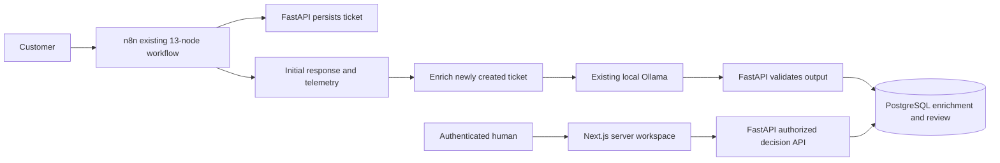
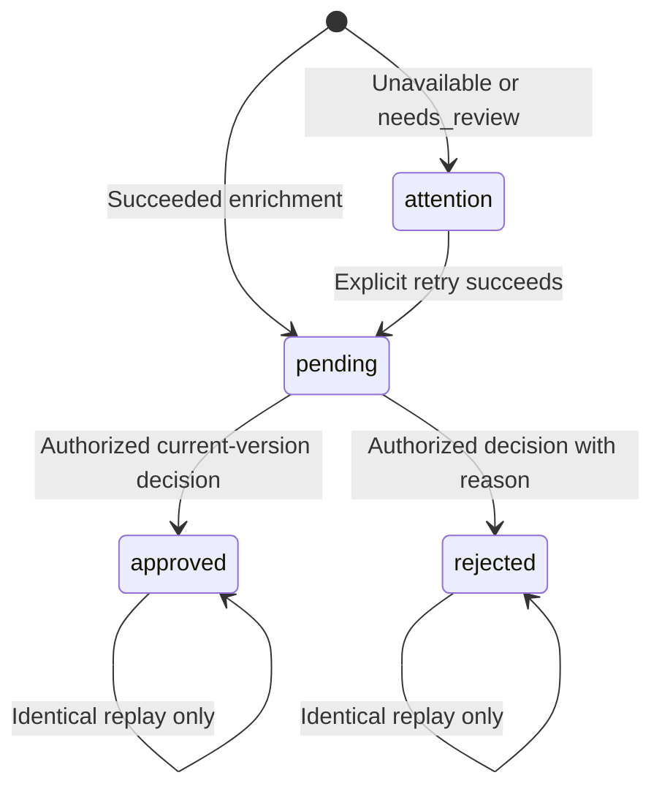

# Implementation 05 — Human approval and Next.js dashboard

Verified locally on **2026-10-23 (Asia/Calcutta)**.
Implementation 04 received the authorized **local commit `491b719`** first.
Current branch: `implementation-05-human-approval-dashboard`. Implementation 05
is uncommitted and unpushed. No merge occurred; Implementation 06 has not started.

## Objective and architecture

Provide an authenticated human review boundary for advisory ticket recommendations.
Approval records a decision only: no email, refund, CRM update, customer contact,
external operation or original ticket-state/category mutation follows.



FastAPI owns validation, authentication, decisions, concurrency and persistence.
Next.js presents data and proxies authenticated server requests. The browser never
contacts PostgreSQL or Ollama. n8n still orchestrates intake/enrichment, with its
existing definition/publication/settings unchanged.

The database queue survives browser/service restarts. Keeping n8n executions
waiting indefinitely would duplicate operational state without improving review
durability; no new workflow node or waiting execution is required.

## State machine and version semantics



Initial processing enrichments do not have a review yet. Attention rows distinguish
invalid/unavailable suggestions from valid pending recommendations. They remain
non-reviewable while their enrichment is retried.

Each review uniquely references one enrichment ID. Model/digest and prompt/schema
versions stay on that referenced record. A different enrichment version creates a
new review; it does not erase or invalidate a final historical decision.
Pending/attention queue filters show the latest available enrichment per ticket,
ordered by claim start time and ID. Older pending reviews cannot be approved.
Current means latest available evidence, not deletion of history on config changes.

Clients submit enrichment ID and expected review revision. An attention-to-pending
retry increments revision. Old pages receive 409; final reviews replay only the
identical decision, reviewer and canonical note.

## Additive persistence and migration

`005_reviews` follows `004_ticket_enrichments`. It adds:

- `reviews`: ID, unique enrichment foreign key, state, revision, reviewer, bounded
  note, decision timestamp and created/updated timestamps.
- Restricted foreign-key deletion and checks for valid state, revision,
  reviewer/timestamp consistency and required rejection reason.
- Review state/creation/ID and enrichment ticket/start/ID indexes.
- Review rows and safe creation audit events for existing terminal enrichments.

Existing tickets, enrichments and audit rows are not overwritten. Completion calls
`ensure_review` in the same persistence transaction; no separate queue worker is
needed. Rejection notes are stored once on reviews, not copied into telemetry.

A protected custom-format backup was taken before migration at
`/home/adnan/.local/share/flowforge-ai/backups/implementation-05-20261022T201956Z`.
Its catalog was verified. No production reset, restore or downgrade occurred.
Real upgrade/backfill and constraints were tested in a fresh disposable schema.

## API contracts and concurrency

All review reads/decisions require a backend-validated reviewer bearer session.
Next.js obtains it from the HttpOnly cookie on server-side requests.

| Endpoint | Behavior |
| --- | --- |
| `POST /api/reviewer/login` | Verify local credentials and issue expiring session |
| `GET /api/reviewer/session` | Verify session and return reviewer identity |
| `GET /api/reviews` | Paginated summaries, no ticket body |
| `GET /api/reviews/summary` | Actual ticket/review/enrichment counts |
| `GET /api/reviews/{id}` | Original ticket, exact AI evidence and review state |
| `POST /api/reviews/{id}/approve` | Final approval; no external action |
| `POST /api/reviews/{id}/reject` | Final rejection with required reason |
| `GET /api/reviews/{id}/history` | Ordered safe audit events |

List filters: `status=pending|approved|rejected|attention`, `ticket_id` and
`final_only=true`. Pagination: limit 1–50, offset 0–10000; newest creation/ID first.
Ticket bodies are not fetched in list queries. Indexed correlated latest-version
checks are part of the bounded page query rather than one query per row.

```json
{"enrichment_id":"exact-enrichment-id","expected_revision":1,"note":null}
```

Reject requires a nonempty printable note, at most 500 characters. Extra fields
and unsupported types are rejected.

| Response | Meaning |
| --- | --- |
| 200, duplicate false | Final decision and audit committed |
| 200, duplicate true | Identical final decision replayed |
| 401 | Missing, forged or expired reviewer session |
| 404 | Missing review |
| 409 | Final conflict, stale revision/version, superseded or invalid recommendation |
| 422 | Invalid payload/rejection note |
| 429 | Login attempts limited; wait one minute |
| 503 | Authentication unconfigured or service unavailable |

A per-ticket PostgreSQL advisory lock is shared with enrichment claims. Decisions
then lock the review row, check revision and latest valid evidence, and commit the
decision/audit atomically. A new claim cannot interleave between checking the
latest version and committing. Concurrent conflicting decisions have one winner;
identical submissions have one final audit event. History uses logical revision
before timestamp/ID so equal timestamp precision cannot invert its sequence.

## Authentication and data protection

Argon2 uses `pwdlib[argon2]`; `itsdangerous.URLSafeTimedSerializer` signs one-hour
sessions with a separate random local secret. Every review API call validates the
signature, age and configured identity.

Next.js stores the token in a host-only, HttpOnly, SameSite=Strict cookie; browser
JavaScript receives login success only. The backend receives the hash/signing key
from ignored local configuration; frontend receives neither. No localStorage
secret or public backend credential is used.

State-changing Next.js routes require the exact configured Origin and JSON,
reject cross-site Fetch Metadata and whitelist approve/reject operations.
Backend authenticates bearer headers rather than ambient browser cookies.
Server-rendered pages validate sessions and use uncached requests. Private review
responses use no-store headers. React escapes customer text; raw HTML is not used.
Five failed login attempts per minute trigger process-local throttling.

Cookie Secure is false for this loopback HTTP demonstration. HTTPS would require
Secure cookies and a matching origin; public deployment is outside scope.
Logout clears the cookie, but an independently stolen token stays valid until
expiry. Changing the reviewer signing key and recreating only backend invalidates
sessions. There is no distributed revocation, MFA, recovery or role platform.

Legacy ticket/intake APIs keep their original unauthenticated loopback contract.
Review authentication does **not** protect the entire legacy API. The OS and other
localhost services are trusted; this is not multi-user or production isolation.
Historical/crashed n8n payloads and protected backups retain their documented
privacy limits. Audit metadata contains IDs/state/revision, never passwords,
tokens, raw ticket text or model responses.

References: [ItsDangerous timed validation](https://itsdangerous.palletsprojects.com/en/stable/timed/),
[Next.js App Router setup](https://nextjs.org/docs/app/getting-started/installation).

## Next.js frontend and infrastructure

Next.js 16.4.2, React 19.3.1, TypeScript, Tailwind CSS 4.3.3 and Lucide.
The official Node 22 image supplied Node 22.23.4 because WSL had no native Node.
A lockfile and standalone, non-root Docker image make the setup reproducible.

| Page | Function |
| --- | --- |
| `/login` | Sign-in and expiry/failure feedback |
| `/` | Actual counts, newest pending items and AI/attention summary |
| `/reviews` | Filters, pagination and status display |
| `/reviews/{id}` | Original/AI comparison, confirmations and decision timeline |
| `/history` | Final decisions, reviewer, timestamp and saved reason |

Server components load data; small client components handle confirmation,
refresh, login/logout and duplicate-click suppression. Invalid sessions redirect
to login. Loading, empty and error states are provided. Final decisions remove
action controls. The UI has desktop/mobile CSS, scrollable tables, accessible
labels and keyboard/focus handling. Refresh is explicit; no WebSockets or
additional real-time services. Displayed times use Asia/Kolkata.

Port 3000 was checked before adding one frontend service. All exposed HTTP ports
bind to loopback. Backend recreation deploys code/configuration; existing n8n,
PostgreSQL and unrelated services were not recreated.

## Local setup and demonstration

This machine already runs the dashboard at **http://localhost:3000**, backend at
localhost:8001 and FlowForge n8n at localhost:5679. PostgreSQL stays internal.
Reuse Windows Ollama; no extra model or installation was added.

For a fresh setup, preserving existing configuration and volumes:

```bash
cd /home/adnan/projects/flowforge-ai
docker compose build backend frontend
python3 scripts/setup_reviewer.py
# Hidden password prompts; --generate instead retains a random password only in ignored .env.
# Take a protected application backup before migration.
docker compose run --rm --no-deps backend alembic upgrade head
docker compose up -d
```

The helper refuses to overwrite an existing reviewer and single-quotes Argon2
hashes to protect dollar signs from Compose interpolation. Generated
`FLOWFORGE_REVIEWER_PASSWORD` is retained only in mode-0600 ignored `.env` for
private retrieval; it is not passed to containers. The app uses the hash.

On this machine, sign in as `reviewer`. Inspect the generated password setting
privately in ignored `.env`; never paste it or the full environment into chat.
After Windows restarts, open Docker Desktop and existing Ollama, then run
`docker compose up -d`. Use exactly `http://localhost:3000`: 127.0.0.1 has a
different Origin and is deliberately not accepted by the configured mutation guard.

```bash
curl -X POST http://localhost:5679/webhook/support-ticket-intake -H 'Content-Type: application/json' -d '{"source_event_id":"demo-05-your-unique-id","subject":"Refund request","body":"I was charged twice for my monthly subscription. Please refund the duplicate payment."}'
```

Wait for analysis, refresh the queue, open the item, inspect both sides and confirm
approval. Submit a different source_event_id to demonstrate rejection with a reason.
Inspect Decision history and its timeline. Original ticket state/category stays
unchanged. An invalid/unavailable result appears under Needs attention and cannot
be approved. The existing explicit enrichment retry can move attention to pending
after a valid result, with a new revision.

## Actual browser and database demonstration

Real browser interactions verified authentication, overview/queue/detail/history,
approval and rejection confirmations, final states and attention without decision
controls. The following synthetic reviews were used:

- Approved: `0cfa5f05-cfaa-4f35-afbf-9a915941d4e3`.
- Rejected with reason: `8d7d2f99-54ef-434a-a521-4066a0a1a157`.
- Attention: `f1848cd4-653a-4c6d-8781-8cf660f374b2`.

Database verification confirms final identity/note, one final audit per decision,
exact enrichment association and unchanged original ticket/enrichment state.
Screenshot proof is saved outside Git in this chat's visualizations.

`scripts/test_review_integration.py` exercises real n8n/Ollama, protected backend,
Next.js sessions/proxy, duplicate/conflicting submissions and attention rejection.
It reads ignored credentials without printing them, retains synthetic records,
and saves safe IDs/counts in `docs/evaluation/implementation-05-integration.json`.
`--prepare` creates browser demo rows without deciding and stores IDs in a
protected temporary file.

## Executed verification

| Suite | Pass | Fail | Skip |
| --- | ---: | ---: | ---: |
| Backend, including original regression coverage | 159 | 0 | 0 |
| Frontend Vitest / Testing Library | 20 | 0 | 0 |
| Real HITL HTTP integration assertions | 29 | 0 | 0 |
| Normal webhook assertions | 192 | 0 | 0 |
| Enrichment assertions | 21 | 0 | 0 |
| Isolated fault assertions | 39 | 0 | 0 |
| API smoke stages | 8 | 0 | 0 |

Production build, ESLint, TypeScript and npm audit pass; final audit has zero
vulnerabilities, including development dependencies. Backend emits 69 dependency
deprecation warnings. Initial failures in equal-timestamp history ordering and an
invalid rejection race fixture were corrected. Development-tool audit findings
were resolved before final checks.

Tests cover authorization/expiry/throttling, creation/pagination, final transitions,
replay/conflicts, real PostgreSQL races, supersession, attention recovery, migration,
audit and unchanged ticket state. Frontend tests cover API-driven counts,
queue/history/empty data, escaped text, confirmations, reasons, duplicate clicks,
conflict/expiry/login feedback, loading and errors.

Desktop browser behavior was verified. A physical mobile-device browser and formal
accessibility audit were not run; responsive CSS is implemented. Ollama's full
classification benchmark was not repeated, but real inference was exercised
through acceptance tickets. Implementation 04's model-quality limits still apply.

```bash
docker compose exec -T backend pytest -q
python3 scripts/test_review_integration.py
python3 scripts/test_support_workflow.py
python3 scripts/test_enrichment_workflow.py
python3 scripts/test_workflow_faults.py
python3 scripts/smoke_test.py
python3 scripts/verify_workflow_runtime.py
docker run --rm --user 1000:1000 -e HOME=/tmp -e NEXT_TELEMETRY_DISABLED=1 -v "$PWD/frontend:/app" -w /app node:22-alpine sh -c 'npm ci && npm test && npm run lint && npm run typecheck && npm run build && npm audit'
```

Run ticket-writing suites sequentially. Only disposable test schemas and uniquely
named isolated fault containers are removed; synthetic application rows remain.

## Important files

- `backend/app/models/review.py`, `backend/alembic/versions/005_reviews.py`:
  durable state, constraints and additive backfill.
- `backend/app/services/review_service.py`: indexed queue, locking, decisions/audit.
- `backend/app/core/reviewer_auth.py`, `backend/app/api/reviews.py`:
  password/session validation and backend authorization.
- `backend/app/services/enrichment_service.py`: minimal completion hook/shared lock.
- `frontend/app/(workspace)/`: protected overview, queue, detail and history.
- `frontend/app/api/`, `frontend/lib/`: server-only proxy, cookie and origin checks.
- `frontend/components/`: presentation and decision interaction.
- `frontend/tests/`, `backend/tests/test_reviews.py`: focused coverage.
- `scripts/setup_reviewer.py`, `scripts/test_review_integration.py`:
  private setup and genuine integration.
- `compose.yaml`, `frontend/Dockerfile`, `frontend/package-lock.json`:
  loopback-only reproducible runtime.

## Preservation, limitations and Git checkpoint

Preservation evidence compares baseline record hashes, n8n definitions/history/
executions, existing credentials, mounts and unrelated container identity/start
times. New reviews, audit entries and synthetic records are additive. No direct
n8n database writes, workflow republishing, credential rotation, volume deletion,
public exposure or unrelated recreation occurred.

Remaining limits: one trusted local reviewer; no individual token revocation on
logout; process-local throttling; legacy APIs remain unauthenticated on loopback;
model errors/abstentions and manual attention recovery; no external action runner.
Production identity, large-scale queues and multi-tenancy are outside this milestone.

Recommended message: `feat: add authenticated human approval dashboard`.

Implementation 05 stays uncommitted, unstaged and unpushed for user review.
Implementation 04 is local commit 491b719; no branch was merged/deleted.
Do not start Implementation 06 without instructions.

Machine-readable acceptance, database proof, preservation hashes/counts, changed
file inventory and secret-scan results are recorded in
`docs/evaluation/implementation-05-acceptance.json`. The full HTTP integration
result is `docs/evaluation/implementation-05-integration.json`.

Measured Docker memory snapshot: frontend 47.89 MiB, backend 72.59 MiB, n8n
472.8 MiB and PostgreSQL 57.76 MiB. These are snapshots, not peak measurements;
Ollama's separately measured footprint remains documented in Implementation 04.
