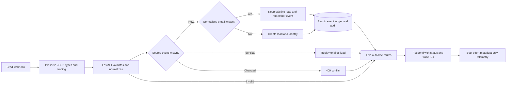

# Implementation 06 — Deterministic lead intake and deduplication

Accepted locally on **2026-10-23 (Asia/Calcutta)**. Implementation 05 was
checkpointed first as `7625989a51561bb898ccb2ec5087312cc93036c2`.
The user subsequently authorized the Implementation 06 checkpoint, fast-forward
of main, and normal GitHub publication of main and the 04–06 feature branches.
The engineering acceptance evidence below records the pre-checkpoint snapshot;
current commit/publication state is verified through Git refs. No branch deletion
or history rewriting is part of the publication procedure.

## Objective and architecture

Process synthetic contact-form leads through a second reliable local automation.
Reuse the Implementation 02 mock CRM; FastAPI owns validation and business rules.
No new service, UI page, external CRM, customer contact or AI lead scoring is added.

`workflows/lead_intake.json` defines **FlowForge AI - Lead Intake**,
stable ID `FlowForgeLeadIntake01`, with a separate POST webhook:
`http://localhost:5679/webhook/lead-intake`.



The published support-ticket workflow remains unchanged: 13 nodes, publication
`4a1f9756-89ab-488c-9348-f9fb51e0966e`. Lead data never goes to Ollama.

## Eleven-node inventory

| # | Node | Responsibility |
| ---: | --- | --- |
| 1 | Lead Webhook Trigger | Dedicated POST lead-intake, response-node mode |
| 2 | Extract & Prepare Lead | Preserve original JSON; bounded trace/event metadata |
| 3 | Call FastAPI Mock CRM | POST /api/mock-crm/leads, 5-second timeout, continue transport errors |
| 4 | Route Lead Outcome | 201, 200, 409, 422; all other statuses/errors use unavailable |
| 5 | Format Created Outcome | 201, accepted, created, lead ID |
| 6 | Format Duplicate Outcome | 200, duplicate_replayed, reason event or email |
| 7 | Format Conflict Outcome | 409, fixed safe conflict message |
| 8 | Format Validation Error | 422, fixed safe validation message |
| 9 | Format Unavailable Outcome | 503, fixed retry guidance, no upstream details |
| 10 | Respond to Webhook | Response and correlation/execution headers |
| 11 | Record Lead Workflow Execution | After response; 3-second best-effort metadata POST |

Uses existing Community Webhook, Edit Fields/Set, HTTP Request, Switch and
Respond to Webhook nodes. No Code node or executable customer instruction.
After checking the existing five-workflow inventory, imported only the absent
new stable ID through supported CLI, inactive first; published through the
authenticated editor. No existing workflow was imported, unpublished or edited.
Read-only published export comparison verifies all source keys, nodes,
connections, settings and active state. Both webhook owners are verified.

## Payload and API compatibility

```json
{
  "source_event_id": "unique-contact-form-event",
  "name": "Synthetic Contact",
  "email": "synthetic.contact@example.com"
}
```

Use a fresh event and synthetic email for each genuinely new demonstration.
All three values must be strings. Event ID: trimmed, 1–128 characters.
Name: trimmed, 1–100 characters. Email: trimmed, lowercased and validated by the
existing Pydantic EmailStr contract, at most 255 characters after normalization.
No Gmail-specific dot/plus handling, fuzzy matching or name-based merging.
Names remain case-sensitive for event-content comparison. Existing extra-field
ignore behavior and canonical hash inputs are preserved.

Existing endpoints remain POST/GET `/api/mock-crm/leads` and
GET `/api/mock-crm/leads/{id}`; original fields and the service's two-item tuple
remain supported. No new lead search endpoint was needed.

POST adds `duplicate_reason: null|"event"|"email"` and
`submitted_source_event_id`. Original `source_event_id` always belongs to the
returned persisted lead. For an email duplicate these two event IDs can differ.
GET/list keep their original behavior; optional new metadata defaults to null.
POST accepts validated optional `X-Correlation-ID` / `X-Execution-ID` headers,
selects the audit actor, and returns a correlation header.

| Input | HTTP | Result |
| --- | ---: | --- |
| New event, new email | 201 | One new lead, identity, event and audit in one transaction |
| Known event, identical normalized contract | 200 | Original lead, duplicate_reason event |
| Known event, changed normalized contract | 409 | Fixed safe conflict; no changes to lead/event |
| New event, known email | 200 | Existing canonical lead, duplicate_reason email; remember event/hash |
| Replay of remembered email-duplicate event | 200 | Same lead, duplicate_reason event |
| Changed replay of remembered event | 409 | Conflict even if the new email differs |
| Invalid body/types/trace | 422 | Backend rejects; no lead or event persisted |
| Database/transport unavailable or bounded timeout | 503 webhook | Safe retry with the same event and payload |

The webhook returns identifiers/outcomes rather than names or email addresses.
It identifies the submitted event, including on email duplicates. Backend
business GET/POST responses intentionally contain the persisted lead information.

## Historical duplicates and additive migration

Read-only inspection found **one historical duplicate-email group with 18 rows**
among 19 pre-existing leads. A unique constraint on `leads.normalized_email`
would therefore fail or require destructive rewriting.

Migration `006_lead_intake`, following `005_reviews`, adds only:

- `lead_identities`: normalized email primary key and restricted FK to canonical lead.
- `lead_events`: source event primary key, restricted lead FK and original payload hash.
- Nullable indexed `workflow_runs.lead_id`; existing ticket linkage remains intact.

These two small registries serve separate identities: email ownership and event
replay/conflict history. Reusing only the original lead event column would lose
new event aliases for existing emails. No additional service or queue is needed.

Migration locks the leads table against legacy writers while backfilling.
For each existing normalized email it chooses earliest `created_at`, then
lexicographically smallest ID for a tie. It maps every historical source event
to its **original** lead ID and hash. No lead row, ID, name, status, creation time,
hash or historical event mapping is rewritten. All historical duplicate rows stay
visible in list/get. New events for that email select the canonical registry row;
replaying a noncanonical historical event still returns its historical ID.

Protected pre-migration custom-format backup:
`/home/adnan/.local/share/flowforge-ai/backups/implementation-06-20261022T205740Z/flowforge.dump`.
Directory 0700, file 0600; its restore catalog was read successfully.
A production restore was not performed. Live upgrade to `006_lead_intake` is
applied. Backend alone was briefly stopped during upgrade and recreated from the
new image; no legacy writer window was left between migration and deployment.

For another existing installation: take a protected backup; build backend; stop
only backend; run `docker compose run --rm --no-deps backend alembic upgrade head`;
then `docker compose up -d --no-deps --force-recreate backend`.
Preserve credentials, volumes and historical data. Do not downgrade live migration
006: removing its event ledger would lose alias idempotency.

## Transactions, concurrency and retry behavior

PostgreSQL transaction advisory locks use stable SHA-256-derived signed 64-bit
keys, event first and email second. Concurrent same-event/different-email
requests serialize before identity selection; different events sharing one email
serialize before creation. Lock waits are bounded to three seconds per acquisition.
Primary-key uniqueness and restricted foreign keys provide final database guards.
One integrity-race retry is bounded; unrelated integrity failures are not hidden.

Lead, identity, event and audit commit atomically. Duplicate/conflict audits also
commit; no existing lead is silently updated. An email-duplicate event stores
only its event ID, lead ID and canonical payload hash, not the submitted alternate
name/email payload.

A client timeout can happen after commit. Reuse the **same event and body** on
retry; the ledger resolves the committed outcome. A new event ID is not a safe
substitute for retry intent. No autonomous retry scheduler or exactly-once
delivery claim is made. Database and webhook timeouts bound different layers;
a 503 alone cannot prove that persistence did not occur.

## Privacy and local security

New lead audits contain action, duplicate reason and validated trace IDs.
They omit names, email/domain and raw submitted content. Lead telemetry uses the
existing safe metadata allowlist plus enum duplicate_reason; lead_id is separate
from ticket_id. No upstream error, raw validation input, payload or model response
is copied into operational telemetry.

Published execution settings save neither successful nor failed completed payloads;
manual/progress saving is disabled. Global pruning remains disabled to preserve
historical executions. Names/emails necessarily pass through transient n8n memory
and remain intentionally in business storage. Historical/crashed executions and
protected backups may retain personal information; no complete-erasure guarantee.

Correlation IDs and source event IDs are caller-controlled metadata. Use opaque,
non-PII identifiers; do not embed an email/name in those fields. This limitation
also applies to the existing support workflow.

Backend/frontend/n8n host mappings remain 127.0.0.1 only; PostgreSQL has no host
mapping. Reviewer authentication, encryption keys and ignored .env are unchanged.
Legacy intake APIs/webhooks are unauthenticated local demonstration contracts.
Public ingress would require authentication, HTTPS, rate limits and a separate
security review. No public exposure or new credential is introduced here.

The fault harness shares the tested support harness, choosing the lead export and
mock CRM destination. Two uniquely named disposable containers use tmpfs SQLite
and an isolated synthetic proxy, with no production volumes or credentials.
Fault hooks in the ordinary backend stay **false**.
Only disposable test containers/schemas are removed; business test rows remain.

## Executed acceptance and regressions

| Suite | Passed | Failed | Skipped |
| --- | ---: | ---: | ---: |
| Backend pytest (159 existing + 25 lead tests) | 184 | 0 | 0 |
| Frontend Vitest | 20 | 0 | 0 |
| Published lead webhook (20 scenarios) | 358 assertions | 0 | 0 |
| Isolated lead transport/telemetry faults | 36 assertions | 0 | 0 |
| Existing published support webhook | 192 assertions | 0 | 0 |
| Existing enrichment workflow / real local Ollama | 21 assertions | 0 | 0 |
| Existing support transport/AI/telemetry faults | 39 assertions | 0 | 0 |
| Authenticated review integration | 29 checks | 0 | 0 |
| API smoke | 8 checks | 0 | 0 |

Frontend production build, lint, TypeScript and npm audit also passed;
npm audit reported zero vulnerabilities. Backend emitted 91 existing/library
deprecation warnings across the expanded suite. An initial new-test import
collection error was corrected before both complete 184-test runs.

Fixtures: `backend/tests/fixtures/lead_intake.json`. Normal scenarios cover new,
event replay, existing email, alias replay/conflict, source conflict, email case,
whitespace, invalid email, missing fields, multiple wrong field types, array/null/
string bodies, invalid/oversized tracing/event metadata, and two genuine
six-request live concurrency cases. Live suite created exactly three synthetic
leads. Backend tests independently verify six-connection PostgreSQL races, bounded
lock contention and a real migration with historical duplicate IDs/timestamp ties.

Fault cases verify real HTTP 503, refused connection, TCP RST, pre-persistence
timeout, post-persistence timeout and telemetry outage. Both five-second request
timeout assertions observed 4.5–8 seconds; retries after persistence return the same
lead, with exactly one business row. Failure details/canaries remain hidden.
Telemetry outage does not change the already-delivered 201 response.

Real review regressions exercise authentication, Origin rejection, actual local
Ollama evidence, approval/rejection persistence, replay/conflict safety and
unchanged original ticket state. Historical Implementation 05 evidence is retained;
`--output` selects a new regression report destination. Smoke uses a fresh email
per run now, because a fresh event alone no longer means a fresh business identity.

```bash
docker compose exec -T backend pytest -q
python3 scripts/test_lead_workflow.py
python3 scripts/test_lead_faults.py
python3 scripts/test_support_workflow.py
python3 scripts/test_enrichment_workflow.py
python3 scripts/test_workflow_faults.py
python3 scripts/test_review_integration.py --output docs/evaluation/implementation-06-review-regression.json
python3 scripts/smoke_test.py
python3 scripts/verify_workflow_runtime.py
docker run --rm --user 1000:1000 -e HOME=/tmp -e NEXT_TELEMETRY_DISABLED=1 -v "$PWD/frontend:/app" -w /app node:22-alpine sh -c 'npm test && npm run lint && npm run typecheck && npm run build && npm audit'
```

Run application-writing suites sequentially without unrelated writers.
No model benchmark was repeated; Implementation 04's 12-example synthetic
evaluation limitations remain unchanged.

## Local demonstration

```bash
RUN="demo-$(date +%s)-$RANDOM"
curl -i http://localhost:5679/webhook/lead-intake \
  -H 'Content-Type: application/json' -H "X-Correlation-ID: corr-$RUN" \
  -d "{\"source_event_id\":\"$RUN\",\"name\":\"Synthetic Contact\",\"email\":\"$RUN@example.com\"}"
```

Expect 201 with lead_id, source event, execution ID and correlation ID.
Repeat the identical request: 200, same ID, duplicate_reason event.
Change only event ID: 200, same ID, duplicate_reason email.
Change the name while reusing either remembered event: 409.
GET `/api/mock-crm/leads/{lead_id}` confirms the original stored name.
GET `/api/workflow-runs/{execution_id}` shows metadata after the response,
unless best-effort telemetry was unavailable.

## Preservation and limitations

Preservation evidence: `docs/evaluation/implementation-06-preservation.json`.
Every baseline application record and value is retained. When comparing historical
workflow_runs JSON hashes, the newly added null lead_id column is excluded.
All five existing workflow definitions, four inactive drafts, 25 history versions,
333 execution/data rows and credential state remain unchanged. One new workflow
and one new history version were added. Personal n8n still has **37 workflows**;
its volume was inspected read-only. All pre-existing containers except the
authorized backend keep identity, image, start time, environment and mounts.
SentinelPOMDP/Neo4j, persistent volumes, credentials and .env are preserved.
No Ollama configuration, tag, model download or model file operation was needed.

Known limits:

- Exact normalized email is a chosen business identity, not proof of a person's
  identity. Shared/reassigned mailboxes may represent different people.
- Existing email matches intentionally do not update names; no merge/update UI.
- Historical duplicate rows remain, and old event replays can return different
  historical IDs for one email. This preserves backwards compatibility.
- Hashes are content fingerprints, not encryption; business data remains sensitive.
- PostgreSQL provides concurrency guarantees; SQLite unit tests are sequential.
- All writers must use the intake protocol. Direct SQL/legacy services bypassing
  registries are unsupported.
- Telemetry is best effort, with no outbox/reconciliation queue. A crash after
  business commit can leave a missing workflow-run row.
- Local unauthenticated ingress trusts this machine. No production security or
  load/soak certification is claimed.
- Existing deprecation warnings remain. No external integration or follow-up
  business action is performed.

Interview concepts: delivery vs processing idempotency, event keys vs business
keys, immutable history, deterministic normalization, constraints plus transaction
locks, atomic audit, post-commit response ambiguity, retry intent, bounded failure,
PII minimization, additive migrations, and separate orchestration/business logic.

## Final acceptance A–N

A. Implementation 05 local checkpoint: `7625989`, exactly 63 approved files;
staged secret/whitespace checks passed, clean tree verified before branching.

B. Architecture: local lead webhook → authoritative FastAPI → PostgreSQL →
structured response → best-effort safe metadata.

C. Separate published 11-node workflow above; source/runtime equality verified.

D. Reused mock CRM, additive response/tracing fields, two identity registries,
nullable lead telemetry link; migration 006 applied with protected backup.

E. Trim and lowercase/EmailStr validation; event conflict checked before email;
remember email-duplicate events; never overwrite historical records.

F. Exact executed counts are in the acceptance table, all final failures/skips zero.

G. Live 201/200(email/event)/409/422, preserved lead IDs, no overwrite,
case/trim normalization, trace metadata and concurrent one-creator behavior passed.
Unavailable/timeout routes were demonstrated only in isolated n8n.

H. Backend, frontend, support, actual enrichment and authenticated review
regressions all passed; support definition/publication unchanged.

I. Existing records/resources preserved as verified by baseline hashes, container
metadata, named mounts and the 37-workflow read-only personal n8n inventory.

J. Loopback ports, unchanged auth/credentials, no raw PII in new telemetry,
no-save completed executions, fixed error messages, no AI lead processing.

K. Local ingress, best-effort telemetry, exact-email business policy and preserved
historical duplicates remain documented limits; no critical acceptance blocker found.

L. Before the authorized checkpoint: branch `implementation-06-lead-intake`,
HEAD `7625989`, with Implementation 06 unstaged/uncommitted. Snapshot inventory
and safety checks:
`docs/evaluation/implementation-06-acceptance.json`. Later publication uses a
separate Implementation 06 commit, fast-forward main and normal pushes only.

M. Authorized checkpoint message: `feat: add deterministic lead intake and email deduplication`.

N. No local setup action is required. The user accepted this report and authorized
the checkpoint and GitHub publication of 04–06. The next planned milestone is
Implementation 07 (daily operations digest); begin it only under new instructions.
