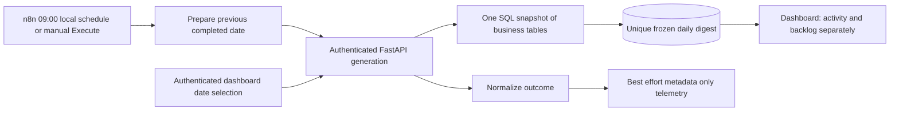

# Implementation 07 — Daily operations digest

Implemented and verified locally on **2026-10-23 (Asia/Kolkata)**.
Branch: `implementation-07-daily-operations-digest`, based on published main
`29aa141eb69466f2bfa7869c64ccd4922fa4f31c`.
Accepted by the user for the intended local-first scope. The authorized local
checkpoint follows staged-content and published-workflow verification; no push or
merge is authorized. Implementation 08 starts on a separate branch after it.

## Objective and architecture

Produce a deterministic aggregate report for one completed local calendar day,
using the existing business tables. FastAPI owns every counting rule; n8n
schedules a bounded call; the existing authenticated Next.js workspace shows
saved reports and permits explicit one-day backfill.



No new production service, model, external recipient, paid API or notification
channel. Existing support/lead workflows and reviewer decisions are unchanged.
Generating a digest creates only a report and safe audit/telemetry records.

## Daily reporting and exact aggregation rules

Let `S` and `E` be the stored UTC boundaries. Every period filter is
`timestamp >= S AND timestamp < E`. All count expressions are scalar subqueries
in **one SELECT**, sharing one PostgreSQL MVCC snapshot. Its
`statement_timestamp()` becomes the report's generation/snapshot timestamp.
No raw customer columns are selected into the metrics.

| Saved activity metric | Exact source/counting rule |
| --- | --- |
| tickets_created | COUNT(*) FROM tickets WHERE created_at in [S,E) |
| canonical_leads_created | COUNT(*) FROM lead_identities JOIN leads ON leads.id=lead_id WHERE leads.created_at in [S,E) |
| lead_requests_observed.created_records | COUNT audit_events WHERE event_type='lead_created' AND timestamp in [S,E) |
| lead_requests_observed.event_replays | Duplicate-received audit rows in [S,E) with duplicate_reason='event' OR action in ('duplicate_lead_event_replayed','concurrent_duplicate_resolved') |
| lead_requests_observed.email_matches | Duplicate-received audit rows in [S,E) with duplicate_reason='email' OR action='existing_email_preserved', excluding the replay branch above |
| lead_requests_observed.legacy_duplicates | All duplicate-received audit rows in [S,E), minus classified replays and email matches |
| enrichment_results_completed.succeeded / needs_review / unavailable | COUNT ticket_enrichments WHERE completed_at in [S,E) AND status equals the respective value |
| review_decisions.approved / rejected | COUNT reviews WHERE decided_at in [S,E) AND status equals the respective value |

Duplicate-received means `event_type='lead_duplicate_received'`. Null JSON metadata
does not turn an unclassified legacy row into a replay/email match; it remains
in legacy_duplicates. Replay has precedence over contradictory email metadata.
Conflicts and validation failures are not accepted lead-request observations.

Current-state metrics are separately stored under `metrics.snapshot`:

| Snapshot metric | Exact rule, without a reporting-period filter |
| --- | --- |
| pending_reviews | COUNT pending reviews joined to their enrichment, excluding any enrichment superseded by a newer started_at, then higher ID as tie-break |
| attention_reviews | Same latest-version condition for attention reviews |
| processing_enrichments | COUNT ticket_enrichments WHERE status='processing' |

The latest-version predicate is reused from the existing review service, matching
the review queue. Processing is the persisted claim state; interrupted claims may
remain processing until the existing recovery protocol handles them.

Important distinctions:

- Ticket replay cannot increase ticket creation count.
- Only identity-registry canonical leads count as acquired leads. Historical
  duplicate rows remain intact and are excluded as separate acquisitions.
- Created-record audit observations can include historical noncanonical lead
  creation. They are not presented as new canonical leads.
- Lead observations are recorded accepted request attempts, with replay attempts
  separated explicitly. The lead event ledger has **no timestamp**; the digest
  does not fabricate a daily distinct-source-event count from it.
- Best-effort workflow_runs are never a metrics source.
- AI totals count terminal versioned result rows, not unique tickets or inference
  attempts. An explicit retry can change that row's status/completed_at.
- Review totals count final review decisions, not duplicate decision submissions
  or unique customers/tickets. Original final decided_at is preserved on replay.
- Snapshot backlog is captured at generation, including for old backfill dates.
  It is not a reconstruction of backlog at that day's midnight.

The historical 18-row duplicate-email group is unchanged. Its identity registry
continues to select the existing canonical lead.

## Dates, timezone and schedule

Default backend setting: `DIGEST_TIMEZONE=Asia/Kolkata`, configurable through
`FLOWFORGE_DIGEST_TIMEZONE` in ignored local configuration. The IANA name is
validated using Python zoneinfo.

A missing/null reporting_date chooses yesterday in that timezone. Explicit dates
must be ISO `YYYY-MM-DD`, from 2000-01-01 through the previous completed local day.
Today/future days, invalid calendars, timestamp strings, numeric/collection types
and unsupported request fields are rejected.

Each local midnight is constructed independently, then converted to aware UTC.
This handles month/year/leap-day boundaries and 23/25-hour DST days. Production
PostgreSQL stores period_start, period_end and generated_at as timestamptz.
No naive timestamp is used for reporting-period calculation.

Published schedule: **09:00 Asia/Kolkata**, cron `0 9 * * *`.
The prepare expression uses workflow-local `$now.minus({days: 1}).toISODate()`.
Keep the backend setting and workflow timezone aligned when changing zones;
republish the workflow and update its version-controlled export. The UI displays
the report's actual timezone.

Installed Schedule Trigger 1.4 resolves an omitted/default misfirePolicy to
**skip** (verified in the installed scheduler registrar). The editor omits this
default when saving. Jobs do not run while this local n8n is offline. Restart
does not trigger unlimited historical generation.

## API, authentication and idempotency

| Endpoint | Behavior |
| --- | --- |
| POST /api/digests/generate | Reviewer bearer session OR scoped digest service header; body below |
| GET /api/digests | Reviewer bearer required; current configured timezone; date filter and pagination |
| GET /api/digests/{id} | Reviewer bearer required; saved report or 404 |

```json
{"reporting_date":"2026-10-22"}
```

POST 201 creates; POST 200 replays the original report with duplicate=true.
Responses contain ID, date, timezone, UTC boundaries, generation time,
metrics_version=1, validated metrics and status=ready. Trace headers are validated;
generation returns X-Correlation-ID. Private digest responses use no-store headers.

List parameters: reporting_date optional, limit 1–50 (default 20),
offset 0–10000. List response includes timezone and previous_completed_date for
the dashboard. Missing reports return 404; invalid/incomplete dates 422;
unauthorized callers 401; database operational failure 503. Failed aggregation
does not persist invented zero metrics or a partially ready report.

Identity is **(reporting_date, reporting_timezone)**, enforced by a unique database
constraint. First successful generation freezes the metrics and backlog snapshot.
Repeated generation preserves ID, values and generated_at even if source data
changes later. There is no refresh/update/delete endpoint; an extra refresh field
is rejected. This is an explicit reproducible-snapshot policy, not a live report.

Generation uses a transaction advisory lock per date/timezone, a 3-second lock
timeout and 5-second statement timeout, with one bounded integrity-race retry.
Report creation and digest_generated audit commit atomically. Replays append a
digest_replayed audit without modifying the report. Concurrent callers share one
saved report. A timeout after commit is recovered by retrying the same date.

The new random service key lives in ignored mode-0600 .env and in one encrypted
n8n HTTP Header Auth credential. It permits generation only: it cannot read digest
lists/details, access reviews, approve decisions or authenticate a human session.
The browser never receives this service key. Existing reviewer credentials,
signing secret and n8n encryption key are preserved.

## Additive migration and local setup

Migration `007_daily_digests` follows 006 and adds:

- daily_digests with date/timezone identity, aware period boundaries, generated
  timestamp, strict version/status, validated aggregate JSON and safe trace IDs.
- A nullable indexed workflow_runs.digest_id, distinct from ticket/lead linkage.

No business-table backfill, reset, deletion or historical row rewriting.
A protected custom-format application dump was taken before upgrade:
`/home/adnan/.local/share/flowforge-ai/backups/implementation-07-20261023T141907Z/flowforge.dump`,
directory 0700, file 0600. Its restore catalog was checked; no production restore
or downgrade was performed.

For an existing 01–06 installation:

```bash
# Ensure existing n8n owner and FlowForgeLeadIntake01 are configured.
python3 scripts/setup_digest_service.py
docker compose build backend frontend
# Take a protected application database backup first.
docker compose run --rm --no-deps backend alembic upgrade head
docker compose up -d --no-deps --force-recreate backend frontend
```

The setup script appends only a new digest key, refuses to overwrite existing
credential identities and imports one encrypted credential via supported n8n CLI
into the existing FlowForge project. Temporary plaintext import material is
mode 0600 and removed. Repeating setup reuses the credential.
It targets the Compose n8n service, never the personal n8n container.

On this machine migration and setup are already complete. Only backend/frontend
were recreated. PostgreSQL/n8n, volumes and unrelated containers were preserved.

## Published n8n workflow

Name: **FlowForge AI - Daily Operations Digest**
Stable ID: `FlowForgeDailyDigest01`
Source: `workflows/daily_operations_digest.json`

| Node | Purpose |
| --- | --- |
| Daily Schedule | Schedule Trigger 1.4; 09:00 local; manual Execute supported |
| Prepare Reporting Date | Previous local date and bounded correlation/execution IDs |
| Call Digest Service | Authenticated POST; 8-second timeout; continue on HTTP/transport errors |
| Normalize Digest Outcome | created, duplicate_replayed, authentication_required, validation_error or service_unavailable |
| Record Digest Execution | Existing metadata endpoint; 3-second best-effort timeout; digest ID and categorical flags only |

Workflow timeout is 20 seconds. No custom Code node, direct database access or
customer/business action. Telemetry contains no metrics payload, names, email,
customer messages or service key. A completed n8n execution means the control
flow finished; inspect the normalized outcome to distinguish report acceptance
from a safely handled service failure.

Imported only the absent new stable ID, inactive first; published via the
authenticated editor. Runtime export matches source, including normalized canvas
coordinates and the editor's omission of default settings. Existing 13-node
support and 11-node lead workflows remain unchanged.

The initial manual run saved the report but exposed an expression delimiter
spacing error in telemetry. It was corrected and republished before acceptance.
A second actual manual run replayed that same report and saved linked telemetry.

## Dashboard and recovery

Authenticated `/digests` is added to existing navigation. It includes date
selection, explicit generation/backfill, saved reports, status/timestamps,
activity cards/tables, and a separate frozen backlog section. Zero activity and
missing reports have distinct states; service failures offer retry.

Generation goes through the existing HttpOnly-cookie server proxy, with Origin
and JSON checks, bounded input and timeout. Native date-picker values are read
from the form when submitting; browser testing caught and corrected a stale
date-state issue and added a regression test.

After an offline period, start the existing Docker services normally. Sign in,
select each missed completed date and click Generate report. Process dates
deliberately, one at a time. Repeating a date opens the original snapshot.
Changing environment variables requires recreating the affected backend;
restart alone does not reload them. No cloud scheduler or automatic bulk backfill.

## Executed verification

| Suite | Passed | Failed | Skipped |
| --- | ---: | ---: | ---: |
| Backend (184 existing + 30 digest tests) | 214 | 0 | 0 |
| Frontend (20 existing + 13 digest tests) | 33 | 0 | 0 |
| Authenticated digest API/Next integration | 28 | 0 | 0 |
| Isolated digest faults and actual accelerated schedule timer | 44 | 0 | 0 |
| Lead webhook regression | 358 | 0 | 0 |
| Support webhook regression | 192 | 0 | 0 |
| Actual local Ollama enrichment regression | 21 | 0 | 0 |
| Human review regression | 29 | 0 | 0 |
| API smoke | 8 | 0 | 0 |
| Isolated lead fault regression | 36 | 0 | 0 |
| Isolated support fault regression | 39 | 0 | 0 |

Frontend production build, lint, TypeScript checks and npm audit passed;
zero dependency vulnerabilities reported. Backend has existing library deprecation
warnings (106 in the expanded suite).

Tests cover accurate PostgreSQL/SQLite aggregates, midnight/end exclusion,
leap/month/year boundaries, timezone conversion and DST, empty periods,
canonical lead deduplication, audit classifications, superseded review backlog,
frozen replay, six-connection PostgreSQL concurrency, constraints, additive
migration preservation, unauthorized/scoped requests and database unavailability.

Digest fault testing adapts the five production nodes to a six-node disposable
webhook workflow, plus an accelerated scheduled clone. Temporary n8n uses tmpfs
SQLite and a synthetic proxy, with no production volumes. Cases include 503,
refused connection, real 8-second timeout before/after commit, unauthorized,
validation failure and telemetry outage. A genuine 10-second isolated timer
selects the previous local day and safely replays the frozen report. Production
09:00 firing was not awaited during this session; its published configuration
and manual trigger were verified. Only test-owned containers/files are removed.

The first enrichment regression encountered the existing busy fallback while the
preceding support suite's post-response inference was still finishing. After a
bounded idle check, the sequential rerun passed all 21 checks; remaining
model-dependent regressions also passed. No model settings or outputs were
relaxed, and synthetic failure records were preserved.

```bash
docker compose exec -T backend pytest -q
python3 scripts/test_digest_integration.py
python3 scripts/test_digest_faults.py
python3 scripts/verify_workflow_runtime.py
python3 scripts/test_lead_workflow.py --output docs/evaluation/implementation-07-lead-regression.json
python3 scripts/test_support_workflow.py
# Allow post-response inference from the preceding suite to settle.
python3 scripts/test_enrichment_workflow.py
python3 scripts/test_review_integration.py --output docs/evaluation/implementation-07-review-regression.json
python3 scripts/smoke_test.py
python3 scripts/test_lead_faults.py
python3 scripts/test_workflow_faults.py
```

Run model-dependent suites sequentially without competing inference.
Earlier milestone evidence remains unchanged; explicit output paths save current
regression evidence under implementation-07. Synthetic business and digest rows
remain in the application database.

## Security, preservation and limits

The generation service reads aggregate counts only. Period activity cannot be
poisoned by missing/fabricated best-effort workflow telemetry because that table
is not a metrics source. No lead/customer text goes to Ollama through this feature.

All host mappings remain loopback; PostgreSQL has no host mapping. Existing
legacy intake/telemetry endpoints retain their local trusted-machine contract.
No external messages, report sharing or notification destination is added.

No-save settings remain configured for completed/manual/progress execution data;
pruning remains disabled to preserve history. **Two manual digest debug executions
were observed retained by this n8n version despite those settings.** They contain
aggregate/debug data, and the service key was absent from their exported data.
They were preserved. Existing execution/history counts were checked via a
supported encrypted CLI export, interpreted privately in memory. The earlier
per-execution hash baseline was unavailable after host restart, so this check
compares historical counts rather than asserting per-row hash equality.

Business-record hashes and six pre-existing workflow definitions are compared
with the fresh Implementation 07 baseline. Personal n8n still has 37 workflows;
its volume is inspected read-only. Existing reviewer/database/encryption
credentials and unrelated containers/volumes are preserved. New digest service
credential/configuration is the only credential addition. Ollama model files
were not downloaded, changed or removed.

Remaining limitations:

- Immutable reports intentionally do not incorporate later arrivals/retries or
  changed source rows. Refresh/versioned revision support needs a separate design.
- Historical lead counts depend on audit records actually retained; no timestamped
  distinct-event history is invented.
- Current backlog is a generation-time snapshot, including for old dates.
- Timezone identifier is part of identity; use a consistent IANA name and align
  backend/workflow configuration.
- Local schedules require a running machine. Missed dates require explicit backfill.
- Telemetry is best effort; manually retained/debug/historical n8n data and
  protected backups are outside an erasure guarantee.
- A single shared generation key has no independent expiry; keep it private.
- Local legacy endpoints are not public-deployment security boundaries.
- No load/soak, physical-mobile or formal accessibility certification is claimed.

Interview concepts: calendar vs UTC periods, half-open intervals, activity vs
stock metrics, source-of-truth semantics, canonical identity, MVCC snapshot
consistency, immutable reporting, idempotency vs delivery, race protection,
least-privilege credentials, safe retries and offline schedule recovery.

## Final engineering report A–M

A–B. Deterministic local daily digest: n8n → authenticated FastAPI → one PostgreSQL
snapshot → unique frozen report → existing authenticated dashboard.

C. Exact source/counting rules and unsupported metrics are documented above.

D. Minimal protected endpoints, one new aggregate table, nullable telemetry link,
additive migration 007, no historical business-data rewriting.

E. Separate published five-node workflow; existing workflows unchanged;
source/runtime equality and a real isolated timer verified.

F. One Daily Digest page and navigation item, existing authentication/styles,
native date selection, backfill, safe replay, activity/backlog and recovery states.

G. Exact final counts are above and in evaluation/implementation-07-acceptance.json.

H. Production manual trigger saved 2026-10-22; replay preserved its ID/snapshot and
saved metadata. Dashboard generated 2026-10-21 backfill with zero period activity
and a nonzero current backlog, demonstrating the distinction.

I. Aggregate-only payloads, scoped encrypted scheduler credential, preserved
reviewer secrets, loopback exposure and baseline/resource checks.

J. Reporting freezes, missing timestamped event history, offline schedules,
best-effort telemetry and manual debug retention remain explicit limitations.

K. Implementation 07 is accepted for an authorized local checkpoint. Complete changed
file inventory: evaluation/implementation-07-acceptance.json. Main stays 29aa141.

L. Recommended later commit: `feat: add authenticated daily operations digests`.

M. Local setup and publication are complete. User acceptance authorizes the local
checkpoint and a separate Implementation 08 branch. No push or merge is authorized.
