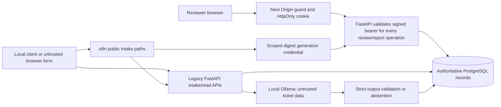

# FlowForge AI security assessment — Implementation 09

Reviewed 2026-10-23; exception investigation updated 2026-10-24, Asia/Kolkata. Scope: one trusted local developer/reviewer,
loopback host bindings, existing Community n8n and Windows Ollama.

**Functional verification and security findings are separate conclusions.**
Application fixes and regression evidence support local functional acceptance.
Unresolved dependency/image findings and unauthenticated legacy ingress prevent
a clean security sign-off or any public/production readiness claim. The user
explicitly accepted these documented residual risks for trusted-local development
only on 2026-10-24; the findings remain unresolved.
No public deployment, platform upgrade, credential rotation or Git publication.

## Final acceptance record — 2026-10-24

The user explicitly accepted Implementation 09 **WITH DOCUMENTED EXCEPTIONS** for
the existing trusted-local development environment. The three exceptions remain
accepted risks, **not resolved vulnerabilities**. Findings and investigation
evidence below are retained without suppression. There is no public production
approval or authorization to commit, push, merge or change original services.

All outstanding work remains open in the
[Implementation 09 follow-up register](implementation-09.md#m-open-security-and-maintenance-follow-ups).
Record actual remediation and its verification before closing an item.

## Architecture, assets and trust boundaries

Sensitive assets: ticket text, lead contacts, reviewer notes, signed sessions,
password hash/signing secret, digest service key, database credentials and n8n
encryption key, workflow history and protected backups. Next receives a session
cookie, not backend authentication secrets or the digest key. n8n stores its
generation header credential encrypted; public exports hold only its reference.

Only reviewer-authorized backend decisions change review state. AI cannot select
endpoints, execute tools, approve itself, alter original ticket state or initiate
customer/business actions. n8n destinations and expressions are trusted static
definitions; customer fields remain serialized data.

The OS, Docker administrators and other local processes remain trusted. Browser
Origin checks on the dashboard do not authenticate n8n or the legacy API. A
malicious website is a distinct threat even when services bind loopback.

## Grounded risk matrix

| Area | Threat / severity in this deployment | Existing protection | Evidence | Residual risk | Required action |
| --- | --- | --- | --- | --- | --- |
| Legacy ingress | Medium: forged intake, data reads by local software, storage/AI resource exhaustion | Loopback, field/transport limits, idempotency, one inference slot | Actual anonymous API use and hostile-Origin form webhook accepted | Browser-form write/CSRF path; no global ingress rate limit or authenticated sender | Before wider use, design scoped ingress auth and quotas across n8n/backend; do not rely on CORS |
| Request parsing | Medium, fixed: unbounded buffering before field validation | New actual byte-counting readers | Backend boundary/chunk tests; genuine chunked HTTP 413 | n8n parses before backend; slow uploads/connections and valid-request flooding are separate limits | Keep limits; set suitable upstream ingress limits during approved platform maintenance |
| Human decisions | High impact if bypassed; no bypass demonstrated | Bearer signature/age/identity, revision/version checks, PG locks and immutable final states | Anonymous/expired tests, hostile Origin, attention rejection, concurrent decision regressions | One shared reviewer; local host compromise defeats boundary | Preserve backend enforcement; production needs distinct identities/MFA/revocation |
| Sessions | Low local residual: copied token survives cookie logout | HttpOnly, Strict, one-hour expiry, no-store, exact Origin | Actual logout deletion and retained bearer verification | Secure=false on loopback HTTP; no per-session revocation | TLS/Secure cookies and revocation before public use; no key rotation without a confirmed need |
| Rendering | No exploitable XSS found | React escaping, CSP, no raw customer HTML, frame denial | Actual Next HTML escapes img/onerror canary; UI tests | CSP allows inline Next bootstrap scripts/styles; not a nonce-based hardened policy | Preserve escaped rendering; consider nonce CSP separately |
| LLM | Model can misclassify or follow injected instructions | Advisory-only, strict enums/schema, fixed reason, pin, no executable authority | Real model + marker attention case, literal n8n expression, backend malformed/tool/timeout tests | Heuristic injection filter has bypasses; schema-valid wrong results remain possible | Human review; never convert advisory output directly into actions |
| Persistence | Lost responses, race, interrupted transaction | Unique constraints, atomic audit, locks, tokens and explicit retry | Real PG races, session termination rollback, restart/lease tests, frozen report replay | No outbox/sweeper/exactly-once delivery; stale claims need explicit POST | Follow recovery runbook; preserve identities and bounded attempts |
| Privacy/telemetry | Local records/history/backup disclosure | Allowlisted metadata, private files, no-save future execution settings | Business/execution/credential hash comparison and secret scans | Historical/manual/crashed payloads persist; IDs can contain caller PII; telemetry is unauthenticated/best effort | Use opaque IDs; protect backups and OS; separately agree retention/auth policy |
| Workflow version history | Medium operational: autosaves disappear despite execution pruning disabled | Current definitions and prior encrypted entity export retained | Older export has 14 versions, current has 9; all five missing versions were autosaved | Independent n8n compaction; exact removal timing/cause unproven; no pre-09 version-row baseline | Resolve supported retention/backup policy in approved maintenance; do not restore tables directly |
| Dependency images | Upstream scanner ratings include critical/high; application reachability not established for all | Non-root app runtimes, loopback, fixed workflow node set; installers removed | Four-image Scout evidence below | Remaining packages require triage/platform maintenance; scanner matching is not proof of exploitation | Approve separately tested platform patches; no blind transitive overrides or normal DB recreation |
| Test tooling | Upstream moderate pytest CVE, mitigated locally | Random owner-only temporary base; dedicated schemas/containers | Filesystem mode/owner test; current scanner retains advisory | pytest 8.4.2 package remains affected outside this mitigation | Review pytest/pytest-asyncio major upgrade compatibility; do not call scan clean |

## Confirmed defects and focused fixes

- FastAPI had no whole-request byte ceiling. Large ignored extras were fully parsed
  before field validation (pre-deployment probe returned 422, not a size rejection).
  A pure ASGI reader now enforces **65,536 actual bytes**, including chunked/missing
  or misleading Content-Length, before JSON parsing and persistence. Excess is 413;
  malformed/too-deep/invalid encoding JSON is sanitized 422; invalid lengths 400.
  Inclusive boundary and existing extra-field ignore behavior are tested.
- Login/decision proxies relied on Content-Length; digest read the entire text
  before checking JavaScript character length. A shared streaming reader enforces
  4096 bytes for login/decisions and 1024 for digest, cancels oversized streams and
  rejects non-object/malformed JSON with 422. UTF-8 bytes count correctly.
  These deliberately documented transport/error changes preserve valid payloads.
- Malformed frontend requests previously fell through to generic 503 responses.
  They now distinguish client errors from backend/service unavailability.
- All FastAPI /api responses now carry private/no-store, including legacy reads
  and errors. This reduces caching; it does **not** add authentication.
- Implementation 08 added pool_timeout to SQLite's incompatible memory pool.
  Reproduction failed during import; the option now applies only to PostgreSQL.
- Disposable recovery tests could mistake PostgreSQL's temporary init server for
  the final process. They now check PID 1 is postgres before accepting readiness.
- Build installer pip is pinned to 26.2.2 for verified installer fixes, then removed
  from the backend runtime. npm remains only in the frontend build stage and is
  removed from its standalone runner. No application dependency version changed.
  A constraints file freezes the reviewed installed Python application/test set.
- pytest uses a random tempfile.mkdtemp base with owner-only permissions. This is
  a mitigation, not an upstream package fix or reason to hide its audit finding.

Upstream evidence: [pip release history](https://pip.pypa.io/en/stable/news/) and
[pytest 9.0.3 security fix](https://github.com/pytest-dev/pytest/releases/tag/9.0.3).
The latter is a major-version change from the existing test stack, so it was not
silently applied. No framework major upgrade or npm package upgrade was bundled.

## Endpoint, authorization and resource review

| Surface | Contract / authorization / bounds |
| --- | --- |
| POST/GET tickets and ticket audit | Existing unauthenticated local contract; bounded fields and pagination; source-event idempotency; original text intentionally returned |
| POST enrich / GET enrichment | Existing unauthenticated local contract; validated tracing, pinned local model, 25s total model bound, three attempts, one process-local slot |
| POST/GET workflow-runs | Existing unauthenticated metadata contract; allowlisted safe_detail, parameterized filters, unique workflow/execution; source labels are not verified identity |
| POST/GET mock-crm leads | Existing unauthenticated local contract; canonical event/email registries, atomic audit and bounded lock waits |
| Reviewer login/session | Argon2 + signed expiring session; bounded credentials; process-local 5-attempt/60s throttle |
| Review list/detail/history/approve/reject | Reviewer bearer on every operation; strict decision payload, bounded notes/pages, latest evidence/revision and immutable final decision |
| Digest generate | Reviewer bearer OR scoped scheduler key; no extra fields, completed date, transaction lock and immutable unique date/timezone report |
| Digest reads | Reviewer only; service key cannot read or approve; pagination/timezone bounds |
| /health /ready | Sanitized public liveness vs SELECT 1 readiness; optional AI never gates readiness |
| /api/reviewer/dependencies | Reviewer only; local bounded metadata check, no inference or upstream error response |

SQLAlchemy parameters carry attacker values, not SQL source. The static
migration/test-schema SQL uses generated trusted identifiers. Actual SQL
metacharacter tests preserve tables and idempotency. PostgreSQL constraints,
rollback, six-worker races and migration tests through **007_daily_digests**
execute in isolated schemas; the normal DB is never downgraded.

Legacy extra-field ignore/coercion behavior is intentionally preserved where
already part of the contract; not every schema is globally strict. Review, digest
and model contracts explicitly reject extras/unsupported types. Trace identifiers
use the existing 1–100 safe ASCII contract. Some legacy pagination offsets remain
unbounded above but SQL statement timeouts apply; there is no global HTTP/CPU
deadline or global storage/rate quota.

n8n's installed endpoint configuration defaults payloadSizeMax=16 (MB setting)
and formDataFileSizeMax=200, with no payload-size override. The new backend limit
does not bound work already done by n8n's parsers. Origin tests recorded actual
lead-form acceptance with HTTP 200, demonstrating a write path despite browser
same-origin restrictions on reads. Browser-specific local-network prompts are not
an application security guarantee. Changing webhook auth/contract or n8n limits
requires a coordinated, explicitly reviewed maintenance change.

## Workflow security and retention

Stable definitions remain support/lead/digest: 13 / 11 / 5 nodes, sole expected
production webhook owners, source/export/published parity verified. Four inactive
drafts remain. No import, publish, unpublish or deletion occurred.

No Code node, eval of customer text, user-controlled destination URL, arbitrary
tool execution, email/CRM action or model-driven business action. The new literal
`{{ 7 * 7 }}` canary is persisted unchanged. HTTP timeouts remain bounded:
intake 5s, telemetry 3s, enrichment request 35s, digest generation 8s, digest
workflow 20s. Digest generation uses the existing encrypted scoped header
credential reference, with no raw value in JSON exports.

No-save success/error/manual/progress settings remain and execution-data pruning
is disabled. The retained 335 execution entities and 335 data rows match the older
encrypted export exactly; one encrypted credential also matches.

**Workflow version history is a separate preservation exception:** the retained
Implementation 07 entity export contains 14 version rows; the current export has
nine. Five autosaved versions are absent (four support autosaves from October 22,
one digest autosave from October 23). The nine retained rows are identical.
Current seven workflow definitions and all three published versions match the
fresh pre-09 baseline/source. No operator import, publish, history deletion or
table write was performed in 09.

Installed n8n 2.43.8 runs workflow-history optimization and separate age pruning
independently of execution pruning. The final
[exception investigation](implementation-09-exception-review.md) replayed actual
pure grouping rules in memory: four missing autosaves would be compacted, but
the earliest 24-node support draft would remain. Community's default 24-hour
age pruning separately makes all four support autosaves eligible after the older
archive. No stored license certificate/override was found; pruneTime=-1 still
defers to a finite license limit. No historical task execution is proved.
Both encrypted archives are now protected in 0700/0600 backup storage outside Git.

The optimizer's default recent optimization window is 15 minutes to 2h15m old,
running hourly and on startup; it merges additive autosaved edits. Older trimming
is a separate task. This is consistent with the missing autosaves, but no retained
debug log or pre-09 version-row baseline establishes exact timing/cause. The
earlier statement that disabled execution pruning preserves all workflow versions
was too broad. No retention setting was changed; prior encrypted versions remain
in the protected export outside Git. Review supported controls and backups in an
isolated candidate before approving any production maintenance/restoration.
This unresolved gap prevents an unconditional all-resource preservation sign-off.

Two earlier manual debug runs remain alongside historical payloads. No-save
settings do not erase historical/manual/crashed data. No historical data was
sanitized by deletion during this review.

## LLM safety

qwen2.5:3b-instruct with the existing complete digest remains the only selected
local model. No extra model/download/external inference API. Untrusted subject/body
are JSON-wrapped in the user message. Output allows only category/priority enums,
a bounded printable reason and optional finite confidence; extras, duplicate
keys, tool calls, malformed/oversized/truncated output and wrong metadata fail
closed to attention/unavailable. Raw model-written reasons are discarded for
fixed category explanations. Metadata/output sizes and deadlines are bounded.

Original tickets, enrichment evidence and human decisions remain separate rows.
Concurrent claims, bounded unavailable retries and stale lease-token rejection
are tested. A classifier error cannot approve itself or invoke customer actions.
The old 12-case synthetic evaluation was not rerun and is not production accuracy.

## Dependency audit results

npm audit: **0 findings**, including dev dependencies. No npm lockfile changes.

pip-audit 2.10.1 audited the installed runtime/test inventory from an ephemeral
auditor. Initial output had 14 raw advisory entries in two packages: six unique
pip advisories plus one unique pytest advisory (duplicate database aliases/entries).
After installer update/removal, **2 raw entries / 1 unique advisory** remain:
pytest CVE-2025-71176 / GHSA-6w46-j5rx-g56g. Do not equate scanner execution success
with zero findings. Application dependencies were held at their reviewed versions.

Docker Scout 1.23.1, local image root filesystems, scan-date snapshot:

| Image | Critical | High | Medium | Low | Unspecified | Rules / occurrences |
| --- | ---: | ---: | ---: | ---: | ---: | ---: |
| backend | 0 | 1 | 2 | 26 | 0 | 29 / 29 |
| frontend | 0 | 0 | 0 | 0 | 1 | 1 / 1 |
| n8n | 9 | 46 | 47 | 8 | 31 | 141 / 143 |
| postgres | 4 | 32 | 29 | 7 | 2 | 74 / 74 |

These are scanner rules and package-location occurrences, not an independently
deduplicated count of exploitable application vulnerabilities. Alias overlap is
retained honestly. Full package IDs/fix versions, image IDs and raw-report hashes
are in `evaluation/implementation-09-images.json`; raw SARIF remains outside Git.

Backend high matches fell 6→1 and frontend 10→0 after removing runtime installers.
The backend remaining high is CVE-2026-85091 in Debian zlib, reported not fixed.
The frontend unspecified match is CVE-2026-107891 in Alpine musl (fix 1.2.6-r6).

PostgreSQL critical Go standard-library matches are located in the gosu entrypoint
helper. The database protocol is not a Go network server. This reduces observed
network reachability; it does not certify the whole image unaffected. n8n has
critical matches in curl, OpenSSL, brotli, simple-git/argv-parser and Handlebars.
Current workflows do not use Git/Handlebars/email/MCP nodes, but its editor and
whole runtime have broader surfaces. High matches also include HTTP-client
libraries; not all reachability has been resolved. Normal PostgreSQL/n8n were
kept unchanged. Do not patch internal node_modules blindly or force an untested
platform upgrade. Plan an isolated candidate test, migration/credential/export
parity and approved recreation with existing volumes.

Python constraints and npm lock improve repeatability; Python artifacts are not
hash-locked and base image tags remain mutable. Exact tested image IDs are
recorded. Public deployment requires a fresh platform audit and patch policy.

## Data, secret and recovery protection

Secret scans cover working files and all reachable Git blobs, known active and
retained rollback configuration values and encoding variants, plus high-confidence
provider-token/private-key patterns. No matching secret was found; .env remains
ignored and 0600. This is not proof against every arbitrary unknown secret.
Manual schema/source/export review found no hardcoded active credentials.

All original application row hashes match the fresh baseline except one pending
review legitimately approved by the user during verification. The user confirmed
the approval; reconstructing its original pending fields reproduces the baseline
hash. The decision remains preserved. Zero unexpected business-row changes.
Seven complete workflow exports, retained execution/data rows and encrypted
credential match; the five missing historical autosaves above remain an explicit
exception, not a preservation pass. Only backend/frontend were recreated.
The other 18 original container identities/images/start times/environment hashes,
all mounts and ignored .env bytes are unchanged. Personal n8n still has 37
workflows (read-only count); SentinelPOMDP/Neo4j and credentials remain untouched.
No Ollama model files were downloaded, deleted or modified by this work.

A new protected application backup was actually restored into separate
network=none PostgreSQL/tmpfs with no production mounts. All nine table row-value
hash multisets, latest migration and backend readiness/ticket reads passed.
Normal DB stayed unchanged. --no-owner/--no-privileges means ownership/ACL recovery
is untested. No n8n DB/volume restore, normal restore or full Windows reboot.
See `evaluation/implementation-09-restore.json` for its protected path/hash and
the [recovery runbook](recovery-runbook.md) for automatic vs explicit/manual steps.

## Verification and acceptance boundary

The [Implementation 09 report](implementation-09.md) records exact final counts,
commands, corrections, preservation evidence and changed files. `verify_system.py`
runs frontend checks then the existing suites, isolated recovery, integrated
security scenarios, runtime parity and isolated restore sequentially.
`audit_dependencies.py` and `audit_secrets.py` report separate scan findings.

User decision: accepted with documented exceptions on 2026-10-24, for
trusted-local development only. The platform findings, history-version gap and
legacy ingress risk remain open; milestone acceptance does not resolve them. No claim of commercial production readiness, public exposure
approval, exhaustive penetration testing, physical host recovery, load/soak
certification or perfect LLM accuracy. Implementation 10 has not started.

## Final exception investigation — 2026-10-24

Investigation recommendation: **ACCEPT WITH DOCUMENTED EXCEPTIONS** for the
trusted-local scope; the user has now explicitly approved that limited acceptance. See [the complete review and individual critical/high
catalog](implementation-09-exception-review.md). All 92 scanner rule rows/90 unique
IDs remain visible. Static/source/ELF assessments narrow current reachability;
they do not certify all platform features. n8n Node26.7.0 predates the Brotli
security fix (26.12.1), while frontend Node22.23.4 includes the backport. Additional
Node DNS/TLS high advisories are recorded beyond the prior Scout package list.
No runtime patch or original-service recreation occurred.

History compaction alone explains eligibility of four of five missing versions;
Community age pruning explains eligibility of the other support draft. Actual
historical causation remains unproved. Protected encrypted copies now preserve
the older definitions outside ephemeral storage. The in-database gap remains an
explicit accepted-risk decision, not a restoration claim.

All original 41 proposed files were reviewed; generated JSON is intentional
redacted evidence. Ten documentation/evidence files changed in this follow-up,
bringing the proposal to 44. Backend233/frontend44/smoke8/17 nonmutating ingress
probes and publication parity passed again. Prior fault/recovery/restore/model
suites were reviewed, not all rerun. Secrets/resources were rechecked separately.
